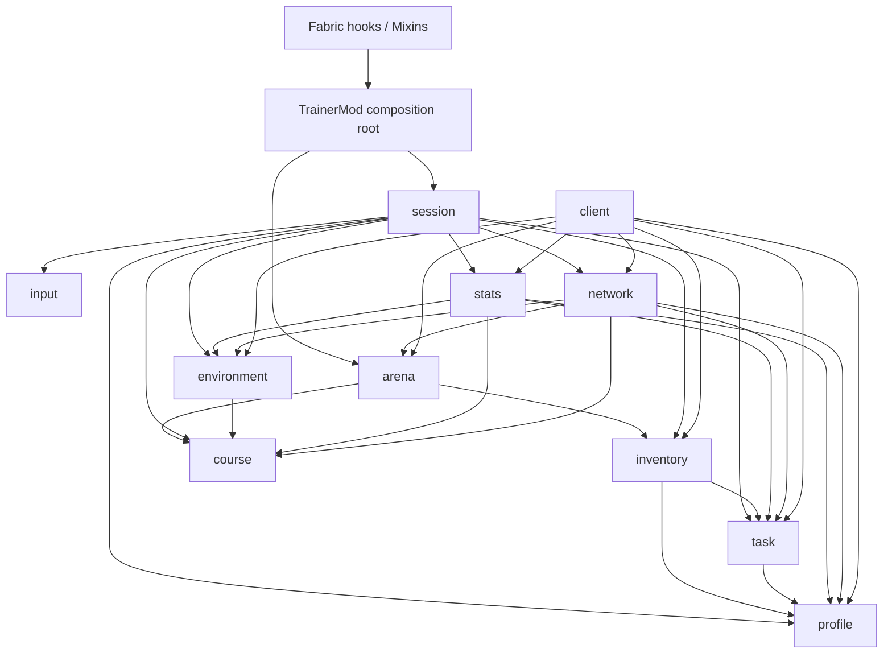

# Hotbar Swap Trainer — architecture

Updated 2026-11-06. Target: Minecraft Java **1.16.1**, Fabric, local integrated server.

## Implementation and safety status

Milestone 1 now has source implementations for profiles/tasks, inventory recovery, stationary sessions, input observation, versioned networking and client controls/HUD. Build and game acceptance results live in [testing.md](testing.md); implementation does not imply those checks passed. Ordinary-world training remains gated: the local owner must explicitly mark a disposable test world with `/swaptrainer enable-test-world`. M3-B separately creates and manages its own path-bound practice save; a disposable marker never authorizes terrain changes.

[The original design proposal](design-proposal-2026-10-28.md) is historical rationale, not the implementation entry point. The [execution record](milestone1-plan.md) tracks remaining acceptance. M2 includes the [slot-order editor](layout-customization.md), [M2-A client options](m2-a-client-options.md), [M2-B profile editing backend](m2-b-profile-editing.md) and the [M2-C visual profile editor](m2-c-profile-editor.md). M2-D/E now add [durable history](m2-d-history.md) and [history/PB browsing](m2-e-history-pb.md); [M2-F acceptance](m2-acceptance.md) separates executed checks from pending physical input. M3-A adds Moving; [M3-B](m3-b-practice-arena.md) adds the owned practice arena. [M3-C](m3-c-parkour.md) adds concurrent Parkour; human route completion remains pending.

[M3-A moving inventory training](m3-a-moving-inventory.md) supports both inventory
modes with a frozen Stationary / Moving option. The user explicitly chose free
movement: stopping never invalidates a task, and no grace/first-movement gate is
present. Accepted horizontal displacement is diagnostic only. The acceptance
record distinguishes build, programmatic runtime and pending human checks.

The remaining automatable M1 acceptance now passed 25 production scenarios with
fresh reopens, including actual stop/mid-write cuts and corrupt-record loads.
[Physical input and visual acceptance](manual-acceptance.md) remain pending.

## Build and entry points

For build and gameplay instructions, see the [user guide](guide.md).

- `gradlew`: Gradle 6.5, distribution SHA256 pinned. `scripts/gradle-jdk8.sh` explicitly chooses JDK 8 via `TRAINER_JAVA_HOME` or macOS java_home.
- Loom 0.4.33, Yarn 1.16.1+build.21, Loader 0.9.3+build.207, Fabric API 0.18.0+build.387-1.16.1. Java source/target 8; production class version 52 is an acceptance check.
- `build-support/LoomCompatibility.groovy` applies one verified downloader compatibility correction to the pinned upstream Loom binary. It changes Accept-Encoding gzip to identity because this historical downloader does not decompress responses. It never modifies the shared Gradle cache; the generated local Maven coordinate and input/output hashes are documented in the build support source.
- `TrainerMod`: common composition root, profile installation, packet registration, server tick/shutdown events and test-world marker command.
- `client.TrainerClient`: client composition root, HUD, keybindings and preparation/GO acknowledgments.
- `fabric.mod.json`: exact Minecraft version and common/client entrypoints. Required Mixins fail closed if the expected old-version hooks do not match.
- `scripts/run-production-smoke.py`: independent non-development Fabric launch in an explicitly owned `run-production/` instance; official client/libraries and pinned Fabric artifacts, offline test identity and a separately remapped optional smoke driver. See [production-smoke.md](production-smoke.md).
- `scripts/run-remaining-acceptance.py`: sequential owned-world lifecycle, protection, corrupt-load and actual mid-write/stop acceptance. The separate smoke mod owns all fault Mixins and artifacts; they apply only to production `accept-*` modes. See [smoke module ownership](../src/smoke/README.md). No fault API enters the production trainer.
- `scripts/verify-owned-smoke-save.py`: read-only, standard-library typed NBT decoder comparing both saved player copies against the 41-slot baseline after the game exits; independent of Minecraft/trainer snapshot code.

Intel JDK8/Rosetta is the original-native client baseline on Apple Silicon; build JVM architecture and native client architecture are distinct. Do not replace historical LWJGL to make a smoke test appear equivalent.

## Modules and dependency direction

All production packages begin with `dev.hotbarswaptrainer`.

| Package | Responsibility / public boundary |
| --- | --- |
| root | `TrainerMod` assembles services; no gameplay logic |
| profile | Immutable stack/rule/profile snapshots; mutable `ProfileDraft` and structural `ProfileDraftValidation`; private `ProfileJson` shares schema/default/NBT validation; `ProfileRepository(Path, ItemCatalog)` alone owns I/O, file-bound edits and backed-up atomic saving/reordering |
| task | Immutable ten-position layouts/tasks, exact `ProfileApplicability` mode preconditions, deterministic Single/Full generators, typed generation failures and `TaskValidator` completion/conservation results |
| inventory | `InventorySnapshot`, versioned `RecoveryRecord`, `ConfirmedPlayerSave`, `InventoryService`, `PendingBlockBreaking` vanilla adapter; snapshot/setup/sync/recovery, runtime stack adapters and `MinecraftItemCatalog` template normalization |
| input | `PlayerActionTracker` records actual vanilla swaps and changed selections; no score/state decisions |
| course | [Pure course contract](../src/main/java/dev/hotbarswaptrainer/course/README.md): immutable deterministic `BasicCourse` geometry and disposable monotonic `CourseAttempt`; no Minecraft, file or consumer dependencies |
| environment | `SessionEnvironment` selects Stationary, Moving or `ParkourEnvironment`; the latter adapts accepted positions/support/teleport acknowledgment to course state. No terrain lifecycle or inventory mutation |
| session | `SessionManager` owns all training state transitions, timing, invalidation, frozen results and the confirmed-restoration gate for world operations; injected environment-aware world-readiness predicate, no arena implementation dependency; package-private `TrainingSession` is server-thread mutable state |
| arena | [Module contract](../src/main/java/dev/hotbarswaptrainer/arena/README.md): unchanged v1 base generator, exact flat/course `ArenaLayout`, strict v1/v2 ownership and conversion, bounded replay and independent saved checks; no session, stats, network or client imports |
| stats | Immutable results/frozen SessionMetadata, strict bounded HistoryJson codec, injected HistoryStore I/O, immutable HistorySnapshot queries and pure PersonalBests derivation |
| network | `TrainerProtocol` bounded DTO encoding and `ServerPackets` decode/queue/send adapter; no client imports |
| client | Client projection, packet adapter, mod keys, validated `ClientOptions`, client-only `ClientOptionsStore` JSON I/O, options screen with raw training-count input, file-bound multi-select profile drafts, client registry picker and shared clipped scroll forms, optional HUD hints, HistoryBrowser snapshots and the two-mode PB table; never reads server session objects |
| mixin / mixin.client | Narrow vanilla adapters. No generation, validation, recovery decisions or scoring rules |

The graph must remain acyclic. Common packages cannot import `net.minecraft.client` or our client packages. `task` has no file, player, network, session or HUD access; `profile` uses immutable Minecraft NBT values for loaded snapshots and separate mutable editor input, and only `ProfileRepository` owns file I/O. `ProfileJson` is a memory-only codec, with no dependency on repository services or task. `inventory` never calls `SessionManager`. Mixins call services assembled by the composition root. `scripts/check-boundaries.py` checks these boundaries and cycles.

## Domain contracts

See [domain.md](domain.md) for JSON schema, classes and test locations.

- Positions **0–8 are hotbar**, **9 is offhand**. These are never ScreenHandler indices; HUD labels hotbar 1–9.
- Stack values deep-copy complete NBT. Equality uses item ID, exact count and structural NBT; compound key order is irrelevant. No hidden identity tags are added.
- REQUIRED accepts one alternative; OPTIONAL is frozen present/absent per task; EMPTY requires empty; FLEXIBLE accepts conserved leftovers and is not a Single Item destination.
- Default: eight REQUIRED, one OPTIONAL and one FLEXIBLE filler permits 8/9/10 stacks. The generator samples only feasible counts.
- Full Inventory constructs a legal target, scrambles through hotbar↔offhand exchanges, and retains a reverse witness. Validator rejects already-solved initial layouts. Bounded retries have a deterministic at-most-100-pair fallback and a clear nontrivial-generation error.
- `TaskValidator` alone owns completion/conservation decisions. It checks actual slots and the complete whole-stack multiset, accepting equivalent duplicate stacks and all configured alternatives.
- Profile display names are nonblank and at most `LoadoutProfile.MAX_NAME_LENGTH`
  (256 Java characters). Profile load/draft validation, editor input, metadata and
  history decoding share this domain contract; invalid existing files stay intact.
- Session profile objects are immutable snapshots. File edits affect a later session. Invalid JSON is preserved and reported, never silently replaced.
- Full profile editing uses a client draft coordinator over the backend: `beginEdit(selectedFile, expected)` binds exact source bytes and ID to an isolated raw-schema draft. `validateDraft` freezes a new structural snapshot without I/O; `save(Edit)` reparses serialized output and the same-directory temporary file, compares normalized semantic hashes, backs up exact bytes and atomically replaces only the selected source. Implicit EXACT defaults remain implicit in drafts/files. Failed validation/saving cannot mutate an existing profile/task snapshot.
- `task.ProfileApplicability` separately reports Single trainability and exact feasible Full counts in 8..10. Full count feasibility does not guarantee a nontrivial sampled task. `TaskGenerationException.Reason` distinguishes mode preconditions from bounded-search exhaustion; saving never requires sampled generation success. The dependency stays task → profile.
- The retained slot-order backend uses its own `ProfileRepository` against the local config directory after restoration. Saving validates a permutation of all ten complete rules, rejects stale/ambiguous profiles, keeps an exact `.bak`, and atomically replaces JSON. Server START independently reloads and freezes the saved profile; no editor state or file paths cross the protocol.

## Runtime data flow and state

All session/inventory writes run on the integrated-server thread. Networking callbacks decode values before queuing work; no retained PacketByteBuf crosses threads.

`BACKING_UP → PREPARING → COUNTDOWN → GO → RUNNING → SUCCESS / INVALID → PREPARING`.
Parkour holds inventory SUCCESS until its independent course also finishes; it
never prepares a second successful task in that run.

Stop, finite successful-count completion, disconnect and shutdown enter RESTORING. Active NBT loaded after a crash is restored before player interaction and committed on the server thread. Recovery failure enters ERROR_LOCKED, keeps the backup and blocks interaction. New sessions cannot bypass recovery.

1. Validate local host, LAN closed, ready owned arena OR explicitly marked disposable test world, normal screen/cursor, safe grounded player and frozen profile. The composition root injects this predicate; neither task algorithms nor inventory world binding change.
2. Deep-copy all inventory slots/selection; attach recovery record and confirm both authoritative save paths before inserting training stacks.
3. Replace training slots and synchronize complete vanilla player ScreenHandler contents, cursor and held slot; send PREPARING task/revision.
4. Client waits for matching inventory/selection, focus, no screen and released Swap Hands, then sends READY. After countdown it draws GO and queues GO_ACK before enabling vanilla swap packets.
5. Server receives GO_ACK, starts `System.nanoTime()` timing and enters RUNNING. It observes each vanilla swap after execution; success freezes immediately before another packet in the same tick. Tick checks are extra integrity checks.
6. Invalid actions have priority over completion. Invalid feedback is followed by a retry; Stationary/Moving success prepares the next task. Parkour success waits for its course. PREPARING waits for closed screens/focus/released key. Finite length counts successful tasks only.
7. Stop restores the snapshot by complete replacement and confirms the cleared-active save before releasing guards. Only after confirmation, history is atomically committed outside the recovery error boundary, then the current-session summary/error is sent to HUD. Post-restore statistics/aggregation/notification failure cannot re-lock the player.

HUD shows phase/progress/time, optional swap counts (default OFF) and final Avg/Best.
Mode/profile labels, selections, mistakes and the completed-session banner are not rendered.
GO/GO_ACK, safety/error messages and underlying counters remain independent of display preferences.

Stats: attempts count vanilla-processed swaps; effective swaps change contents; no-ops do not; slot changes count changed server selectedSlot only. Initialization is excluded. Mistakes = no-op swaps + forbidden actions. Necessary temporary moves and extra legal swaps are not called mistakes. Final timing is server-confirmed GO_ACK-to-completion and includes local scheduling uncertainty; it is not a frame-perfect physical reaction-time claim.

## Owned practice-save lifecycle (M3-B)

The title screen has one Enter practice arena action. It reserves or validates
`saves/hotbar-swap-trainer-practice`, then delegates to the pinned vanilla
creation/load API. There is no second entry in O, previous-world reopening or
world configuration wizard. O retains training controls and adds owned-arena
Reset/Return to title; pause-menu exit uses the same safe exit flow.

Ownership is explicit: strict versioned journal with stable UUID, exact path,
fixed generator/bounds, operation identity and phase; an independent atomic NBT
seal cross-checks the world operation. The original disposable marker permits
training only. Unknown/existing ordinary/old-test directories are never adopted.
Missing/damaged/unsupported/path-mismatched ownership is preserved and rejected
before managed loading/modification. No worlds/regions are deleted or copied to
bypass recovery path binding.

`CREATING -> INITIALIZING -> VERIFYING -> READY`; reset uses
`READY -> RESETTING -> VERIFYING -> READY`. Pending operations replay the same
bounded cuboid, re-dirty chunks and independently confirm saved blocks/settings,
seal and both player saves before committing READY. READY reuse only inspects;
changed ground requires explicit reset confirmation. All block changes run on
the integrated-server thread, in bounded batches, without old block callbacks
that could propagate beyond the owned bounds. Vanilla flat generation avoids a
custom chunk generator or general terrain backup/rollback framework.

Root runs session recovery before arena work. RESET/RETRY/EXIT first pass
`SessionManager.restoreBeforeWorldOperation`; RESTORING/ERROR_LOCKED cannot be
implicitly retried or bypassed. Arena, statistics and notification failures never
change recovery records or invent inventory locks. Client commands are queued
after vanilla input at END_CLIENT_TICK. Exit additionally uses EXIT_RESTORED ->
client EXIT_COMMIT -> snapshot/save confirmation -> EXIT_READY before vanilla
disconnect, preventing late selected-slot echoes from overwriting restoration.
Vanilla renders until the server thread actually terminates after shutdown;
there is no fixed sleep or early stopped-flag assumption. STOPPED releases the
service's server references. Full contracts and exact executed/pending evidence
are in [M3-B](m3-b-practice-arena.md).

## Inventory recovery and protection

See [version-hooks.md](version-hooks.md) for exact 1.16.1 signatures/body evidence and [testing.md](testing.md) for fault injection.

The recovery record is embedded under `HotbarSwapTrainerRecovery` in the same vanilla player CompoundTag as Inventory. It stores schema, active marker, world path identity, player UUID, transaction UUID, original complete inventory/selection and a type-sensitive canonical SHA256 checksum. World copies at another path deliberately fail binding rather than replaying unknown recovery data. Damaged raw records are retained.

The host loads `level.dat/Data/Player` before UUID playerdata. IntegratedPlayerManager captures host NBT in memory on player save. `ConfirmedPlayerSave` calls saveAllPlayerData, then server.save, then reads **both** UUID playerdata and host level.dat. Exact UUID, original/current inventory, selection and expected record are checked. Vanilla save return values are not I/O acknowledgments. Before setup or after recovery, failed readback keeps the original record and protection.

Recovery uses full replacement of 36 main + four armor + offhand + selected slot, never give/merge/drop logic. Replaying an active snapshot is idempotent. The active record is cleared only in a save containing the restored inventory. It is reattached in memory if confirmation fails.

Protection covers the complete transaction, not just RUNNING.
`BlockBreakingProtectionMixin` guards `ServerPlayerInteractionManager.tryBreakBlock`
before any block/tool mutation. `InventoryService.backup` immediately discards active/delayed mining through
the `PendingBlockBreaking` adapter after attaching protection; protected updates
also discard it. Even a START/STOP within one tick cannot replay pending work; ordinary updates resume once recovery protection clears. Exact hooks guard inventory/crafting/creative transfer, drop/break/place/use/entity actions and commands; item/experience/projectile pickup; damage, hunger, healing and status effects. Stationary movement retains the anchor while allowing rotation. Moving passes vanilla locomotion through in every phase and never zeroes velocity/fall distance or forces grounding. Airborne task replacement and in-place restoration need no landing wait; ordinary landing damage can follow confirmed restore/release. Ordinary play has no protection or swap interception after recovery.

Readback verifies process-visible files. Arbitrary power loss, filesystem damage, malicious other mods and inconsistent manual rollback are outside the claim. Ordinary saves remain gated until complete M1 acceptance, including physical input and visual checks, passes.

A failed START may complete a separate confirmed rollback when both files already
contain the original inventory and cleared record. Write denial does not require
retaining a transaction after that desired saved state is independently confirmed.
Automatic fault acceptance has passed; the ordinary-world gate remains while
physical input/visual acceptance is pending.

## Client and protocol

See [client.md](client.md). P toggles start/stop; O opens mode/custom-success-count and target-hint options after stop. Goals are nonnegative signed integers: 0 means unlimited, positive goals count successes only. The UI labels one input Number of successful training tasks (0=unlimited); both protocol decoding and server START reject negative goals. Original swap/number/scroll bindings remain vanilla-owned. Enabled target hints show one legal Full witness/predicates or the Single destination. Hiding those hints preserves rendered GO and GO_ACK; hiding the whole vanilla HUD still safely times out. O → Edit item layout opens the sole training-profile selector; clicking a layout name persists its ID for START, and the adjacent Edit action opens the item-first grid for that exact source after a stopped/restored client acknowledgement (IDLE/ERROR), with LAN closed. `ProfileEditorSession` owns the exact path/expected snapshot/Edit, raw per-item quantity text; screens never own persistence or read server sessions. Nullable draft SNBT/matching fields remain raw. Save rechecks the same gate; failures retain drafts and lock persistence until explicit reload. Successful save loads/begins a new edit on the same path. `ProfileItemCatalog` alone owns editor registry search/previews. `ProfileApplicability` is the explicit client → task assessment boundary; no reverse domain dependency is introduced. Slot clicks open a multi-select catalogue with all selected icons/quantities and marked registry items; `SlotCandidateLayout` owns geometry and clipped hit testing, without changing domain or protocol contracts.

M2-A persists mode, environment, profile, requested successes, Target hints and Show swap counts in local
`config/hotbar-swap-trainer/client-options.json` (schemaVersion 1). Missing files
use SINGLE_ITEM/STATIONARY/default/10/OFF/OFF. Legacy schema-1 files without environment default to STATIONARY without rewriting. Legacy schema-1 files without
showSwapCounts default to false without a load-time rewrite. `TrainerClient` assembles the store, validates
profile availability and owns accepted in-memory options; `ClientOptionsStore`
depends on the option value, TrainingMode, Gson and Java I/O, never on screens,
networking or server services. The screen's incomplete numeric draft stays private.
Accepted changes use a forced same-directory temporary file and atomic replacement,
with no non-atomic fallback. Any load failure preserves the source and disables
configuration writes for that process, with log and options-screen feedback.
Unavailable profiles explicitly fall back to default or the first valid local
profile; an empty catalogue disables Start while leaving Edit item layout available
for catalogue refresh and file-error feedback. See [M2-A scope and verification](m2-a-client-options.md).

Messages carry protocol version, session/task UUID and monotonic revision. Client rejects stale/closed sessions; server accepts phase-appropriate acknowledgments only for the current task. Late or duplicate requests cannot restart a completed task. Statistics cannot affect the recovery transaction.

## M2 history ownership and comparison

The common and client composition roots explicitly inject the same installation
`config/hotbar-swap-trainer/history` root. HistoryStore partitions by player/session
UUID across worlds; it never stores recovery NBT. SessionManager freezes metadata
at START and end state at first stop. `ResultStore` signatures remain compatible;
forget/clear clear memory only. Client HistoryBrowser reads only the current UUID
after local/LAN-closed/IDLE-or-ERROR acknowledgement, once on entry. No
history network endpoint, path packet, server-session access or per-frame I/O is
introduced. `stats → task`, `client → stats`; no upward dependency or cycle.

HistorySnapshot retains its stable filter/page query API. The PB screen renders a
2×2 table: Single Item / Full Inventory headings, then each mode's fastest positive
SUCCESS duration. PersonalBests.fastestTaskForMode derives these from current-player
records for the explicitly selected environment across profile hashes, target hints,
success goals and session end states. The PB title labels the existing options
environment; no second selector is added. Its old two-argument query stays
Stationary, and condition-specific queries continue to separate environments.
Unknown metadata or unsupported timing/scoring/environment versions remain excluded.
PersonalBests.forConditions retains its stricter task/finite-total/average API for
existing consumers; stored metadata is unchanged. There is no persisted PB file or
screen-owned scoring logic. Corrupt history remains preserved and a compact warning
marks incomplete PBs. See [HUD/PB simplification](hud-pb-simplification.md).
Restoration and history remain separate commits; a process exit between them can
lose history without losing the restored inventory.

## M2 configuration usability

[Current flow and ownership](m2-usability-plan.md) and
[verification](m2-multiselect-acceptance.md) describe the direct multi-select editor.
ProfileEditorSession remains the single profile transaction owner; raw quantity
and SNBT belong to its actual allowed-item draft. Screens own only query/focus/
active-icon view state. There is no pending single-item proposal or exchange mode.
One and many allowed items share the same presentation. Explicitly deselecting the
last item becomes EMPTY; custom/special-rule removals confirm, and opening or
additive edits preserve full legacy semantics. O has one Training task count field
with0=unlimited, and hides the routine IDLE/Ready catalogue message. No dependency,
protocol, generation, recovery or history/PB grouping contract changes. Configuration
copy remains in en_us/zh_cn resources via client-only EditorText.

Build verification additionally isolates main/smoke Mixin export ownership. The
pinned old Loom otherwise lets a smoke compile erase main Shadow mappings before
a resource-only remap. `build.gradle` declares the separate outputs and main remap
input; [build-support/README](../build-support/README.md) records the verified
failure/fix. This does not alter game hooks or module dependency directions.

The configuration copy/layout follow-up puts that explanation above the goal
input, keeps slot headers to position/count, and places a labelled item-quantity
field plus Delete on the left. Advanced remains secondary for complete existing
rule/NBT editing. No state ownership or dependency direction changes.

## M3-A environment boundary

TrainingSession freezes the environment ID/instance at START. SessionManager
passes movement through that boundary and publishes/saves the actual environment.
The movement Mixin captures server position after the main-thread fence, then
observes position only at vanilla's accepted increaseTravelMotionStats branch.
teleportRequest clears diagnostic evidence; per-packet before/after positions
avoid counting cross-packet resets. Moving observations have no clock,
speed threshold, scoring, HUD or recovery dependency. Only the last accepted X/Z
segment in blocks is retained; camera/vertical-only/blocked movement contributes
zero. Low TPS and missing observations cannot invalidate a task.

Protocol 3 adds the environment enum to START/views; existing Java factories
default to Stationary and old wire versions fail explicitly. History schema 1
already stores versioned environment text, so its shape is unchanged. Both
stationary-v1 and moving-v1 are supported, but PBs never merge them. No stop-grace
configuration remains after the user's simplified product decision. See the
[M3-A record](m3-a-moving-inventory.md) for verification and manual limitations.

## Current UI acceptance ownership

`scripts/run-profile-editor-ui.py` always selects `client.UsabilityUiSmoke`;
`--usability` and `--history` are compatibility aliases. `UiSmokeControls` owns
current-screen navigation and `ProfileUiSafetyChecks` owns duplicate/corrupt-file
and actual PREPARING/RESTORING/ERROR_LOCKED/retry/LAN checks.
`smoke.ProfileGateAcceptance` owns their server-thread restore fixture; the
bounded restore-observation Mixin applies only to this opt-in production driver.
The obsolete ProfileEditorUiSmoke and its removed-screen workflow are retired.
All these classes remain outside the production mod. See [targeted fixes](code-review-fixes.md).

## M3-C course and coordination boundaries

[Confirmed rules and acceptance](m3-c-parkour.md) are the product source of truth.
Parkour freezes the effective inventory quota at one, irrespective of the saved
Stationary/Moving count. Inventory success holds SUCCESS while the course runs;
course success freezes its own time while the player solves on the finish pad.
SessionManager ends only after both, then confirms inventory restoration before
course-only safe placement. Moving STOP never invokes placement. Invalid inventory
attempts retry SETUP under the original backup; falls never invoke SETUP/backup.

`course.BasicCourse` centrally defines the versioned seed/layout: thirteen 3x3
platforms at block y8, twelve cardinal level jumps over one-block gaps, within the
original cuboid. Every intermediate landing is an ordered checkpoint. Seeded
rotation is deterministic. Emerald/gold/diamond centers mark start/checkpoints/
finish. The flat floor remains below; a fall is detected before reaching it.
Geometry tests are not human playability acceptance.

`CourseAttempt` owns PREPARING/RUNNING/RETURNING/FINISHED/STOPPED, checkpoint,
falls and monotonic elapsed time. `ParkourEnvironment` owns only the vanilla
adapter: exact feet height/full footprint, real support and body collision,
normal locomotion state, accepted airborne/landing sequence, and correction
barriers. Requested positions never award progress. Matching teleport confirms
and a fresh supported observation re-arm checkpoint returns; stale/duplicate
confirms cannot progress. First GO_ACK starts the course clock; later inventory
GO_ACKs cannot reset it. Pause/focus invalidates the inventory attempt as before,
while course elapsed includes pause time. No fall penalty or aggregate score.

Arena journal/seal v2 explicitly records layout ID/seed; the pending journal also
records source ID/seed for the previous seal. The base spec/generator and bounds
remain flat-64-v1. Legacy v1 records keep exact semantics and are read without
rewrite. Conversion archives original ownership/seal bytes before write-ahead
intent. All terrain writers/checkers/readbacks use the target ArenaLayout.
READY grants Parkour only for its matching owned course. Ordinary test markers
never grant Parkour. Explicit UI confirmation precedes each destructive layout
switch; reset rebuilds the current layout. Course return changes no blocks.
START also rereads the seal and checks current platform/jump/headroom blocks in
1,305 bounded comparisons before backup, catching idle player edits. Failure
requires explicit reset; it never repairs terrain automatically. This targeted
preflight supplements the full managed-volume READY and saved readback checks.

Trainer protocol 4 adds a bounded independent course projection; arena protocol 2
adds layout-switch actions and the detached layout flag. Existing Java request
factories still default to Stationary; old wire versions are rejected. Client
options remain schema 1 with PARKOUR as an accepted environment; missing values
still default to Stationary without rewrite. The existing environment selector
is reused. Parkour disables but preserves the count preference. The HUD adds only
course progress/time/falls and arrival/completion feedback.

History schema 1 is unchanged for old environments. Schema 2 adds an independent
CourseResult with course/version/seed, rules/timing versions, elapsed time, falls,
checkpoint and completed flag; completed Parkour sessions require both successes.
Inventory PBs remain per environment and measure only single inventory tasks.
Course time is not their total/average/PB. Unknown comparison conditions cannot
be treated as supported course records. No course leaderboard/history redesign.
Live attempts are not durable: hard cuts may lose their history, recover inventory
first, and start a fresh course without accumulating offline time. Nothing about
course/results enters recovery NBT. Statistics/notification errors remain outside
the inventory restoration failure boundary.
