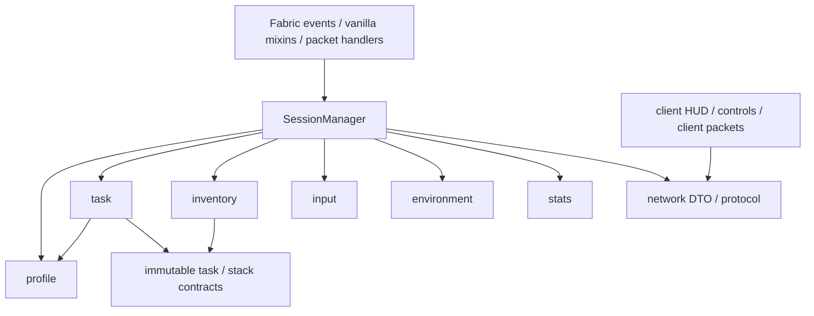

# Hotbar Swap Trainer — 原始设计提案（历史记录）

日期：2026-10-28。范围：Minecraft Java 1.16.1、Fabric、单人集成服务器。

本文是空仓库的设计与执行计划，不代表已有实现。此次仅检查仓库、开发机环境、官方依赖及历史源码/映射；没有执行构建、启动 Minecraft、修改玩家存档或实现 mod。

## 1. 当前状态与推荐范围

- 工作目录为空，尚无 Git、构建文件、源码或现有架构文档。用户提供的 AGENTS.md 内容是本次适用的工程要求。
- 开发机为 arm64 macOS。已有 arm64 Corretto 8/17/21 与 Temurin 25；默认 java/javac 指向 Java 25，没有全局 Gradle。
- MVP 先实现 Stationary 下的 Single Item / Full Inventory、JSON profiles、安全恢复、基础 HUD、输入统计和评分。完整配置编辑器、最优求解、移动和跑酷后置。
- MVP 不生成地形、不改方块。首先在新建的普通原版测试存档验收，不需要下载地图、数据包或命令方块；普通存档的训练入口必须等恢复与交互保护验收后开放。
- 训练时只初始化、清理和恢复库存。RUNNING 阶段所有交换继续走原版选槽与 Swap Hands 路径，mod 不替玩家搬动物品。

## 2. 依赖、Java 与 Apple Silicon

推荐固定以下候选基线。**已确认 artifact 存在、历史路线和相关接口；尚未证明整套组合可构建或运行。**

| 组件 | 候选固定版本 | 核实情况 |
|---|---|---|
| Minecraft | 1.16.1 | 唯一支持目标；mod 元数据必须精确限制 1.16.1 |
| Yarn | 1.16.1+build.21，classifier v2 | 官方 artifact 与 Tiny 映射已检查 |
| Fabric Loader | 0.9.3+build.207 | 官方 artifact 存在；待集成冒烟测试 |
| Fabric API | 0.18.0+build.387-1.16.1 | 官方 artifact、POM 和所需模块源码已检查 |
| Loom | 0.4.33 | 官方固定发布 artifact 存在，替代浮动 0.4-SNAPSHOT |
| Gradle Wrapper | 6.5 | Fabric 官方 1.16.1 历史模板使用此版本 |
| 编译与开发运行 JVM | JDK 8 | source/target 均为 1.8；首选 x86_64 开发客户端基线 |

官方历史模板本身使用 MC 1.16.1、Yarn build.1、Loader 0.8.8+build.202、API 0.13.1+build.370-1.16、Loom 0.4-SNAPSHOT 与 Gradle 6.5。上表是基于同一历史路线、可固定版本和已检查 API 选择的候选组合，不把它冒称为官方测试组合。[历史依赖配置](https://raw.githubusercontent.com/FabricMC/fabric-example-mod/6efb5c4830dd5afcdeceb34e459da47c0ec350a9/gradle.properties)、[历史 build.gradle](https://raw.githubusercontent.com/FabricMC/fabric-example-mod/6efb5c4830dd5afcdeceb34e459da47c0ec350a9/build.gradle)、[历史 wrapper](https://raw.githubusercontent.com/FabricMC/fabric-example-mod/6efb5c4830dd5afcdeceb34e459da47c0ec350a9/gradle/wrapper/gradle-wrapper.properties)。

候选 artifact 的官方依据：[Yarn](https://maven.fabricmc.net/net/fabricmc/yarn/1.16.1%2Bbuild.21/)、[Loader](https://maven.fabricmc.net/net/fabricmc/fabric-loader/0.9.3%2Bbuild.207/)、[Fabric API](https://maven.fabricmc.net/net/fabricmc/fabric-api/fabric-api/0.18.0%2Bbuild.387-1.16.1/)、[Loom](https://maven.fabricmc.net/net/fabricmc/fabric-loom/0.4.33/)。

开发设置与第一道验收门槛：

1. 为 Gradle daemon、IDE 导入和 runClient 显式选择 JDK 8；语言级别 8 无法让 Gradle 6.5 在默认 JDK 25 上运行。Gradle 6.5 官方运行兼容范围为 Java 8–14。[Gradle 6.5 兼容说明](https://docs.gradle.org/6.5/userguide/compatibility.html)
2. Apple Silicon 上先验证 Intel x86_64 JDK 8 + Rosetta + 原始 x86 游戏库。已有 ARM JDK 8 不意味着旧图形库能原生运行；LWJGL 官方在 3.3.0 才加入 macOS ARM 支持。这里的 Rosetta 路线是由旧库限制推导的候选方案，仍需真实启动确认；不在第一轮直接替换 LWJGL。[LWJGL 3.3.0 发布说明](https://github.com/LWJGL/lwjgl3/blob/master/doc/notes/3.3.0.md)
3. 使用仓库 wrapper，无需安装全局 Gradle；固定 distribution checksum、依赖版本和解析结果。Loom 0.4.33 的 POM 仍含 mercury snapshot，需记录实际解析 artifact 与校验值，不能只固定顶层版本就声称完全可复现。[Loom POM](https://maven.fabricmc.net/net/fabricmc/fabric-loom/0.4.33/fabric-loom-0.4.33.pom)
4. 实现阶段先验证依赖下载、genSources、空 mod build 和 runClient，再推进训练功能。若历史仓库失效，先解决这一项，不在未核实情况下换用现代 Loom/API。
5. 验证 remapped jar 能被独立 1.16.1 Fabric 实例加载，且产物 class major version 为 52。构建成功与游戏可玩分别验收。

## 3. 包结构与依赖边界

使用单个 Java mod 工程与普通包；不引入 DI、事件总线框架或多个 Gradle 子工程。以下是职责划分，模型可适量合并，不为每个名词创建接口。

| 包（前缀 dev.hotbarswaptrainer） | 主要类与职责 |
|---|---|
| 根包 | TrainerMod：common 初始化与依赖装配 |
| profile | LoadoutProfile / SlotRule / StackSpec；ProfileRepository：JSON 读取、校验、版本迁移 |
| task | InventoryTask、SingleItemTaskGenerator、FullInventoryTaskGenerator、TaskValidator：生成及纯状态验证 |
| session | TrainingSession、SessionManager：唯一会话状态机；TimingAndScore：时钟与计分规则 |
| inventory | InventoryService：快照、准备、同步、恢复；RecoveryRecord：玩家 NBT 恢复契约 |
| input | PlayerActionTracker：仅记录已由原版处理的玩家操作和违规行为 |
| network | TrainerProtocol：有版本号的消息和 DTO；ServerPackets：服务端入口 |
| client | TrainerClient、ClientPackets、ClientSessionView、TrainerHud、TrainerKeyBindings、TrainerOptionsScreen |
| environment | TrainingEnvironment 与 StationaryEnvironment；之后增加 Moving / Parkour 实现 |
| stats | TaskResult、SessionResult、ResultStore：结果数据及持久化，不介入恢复事务 |
| mixin / mixin.client | 少量原版适配器；不放生成、评分、恢复决策等业务逻辑 |

约束：common 不导入 net.minecraft.client；task 不访问玩家实体、网络、文件或 HUD；inventory 不反向调用 SessionManager；input 产出操作观测，评分与状态转换由 session 决定。Mixin 调用装配好的服务入口，不让领域模块依赖 Mixin。仅使用 Minecraft 已提供的 Gson/NBT 等运行时能力；测试依赖与运行依赖分离。

后续在 docs/testing.md 记录验证流程，在 docs/version-hooks.md 记录确认后的注入点、方法体证据与保存路径。本文在实现时同步更新，不让“拟议设计”伪装成现状。

## 4. 数据模型与配置契约

### Profile 与 StackSpec

LoadoutProfile 包含 schemaVersion、稳定 id、显示 name 和十个位置规则。Hotbar 在领域模型中编号 0–8，HUD 显示 1–9；OFFHAND 单独命名，不把 UI 槽位编号当成 PlayerInventory 或 ScreenHandler 索引。

每个 SlotRule 包含：

- REQUIRED：必须有一堆物品，匹配 alternatives 中任意一个；alternative 是 OR，不是同时生成多堆。
- OPTIONAL：本轮生成时决定有或无。若本轮为 absent，该位置要求为空；若 present，按 alternatives 验证。
- EMPTY：必须为空。
- FLEXIBLE：允许为空或容纳本轮剩余的一整堆物品；仍受全局物品守恒约束，不作为 Single Item 目的地。

StackSpec 包含 registry item ID、确切数量、生成 NBT、匹配规则。MVP 使用确切数量，暂不支持数量区间或任意脚本。物品变体使用实际 ID 或相关 NBT，例如普通/喷溅药水用不同物品 ID，抗火药水检查 Potion 的 minecraft:fire_resistance / long_fire_resistance。生成模板与匹配谓词分开，禁止仅因物品 ID 相同就把所有药水视为相同。NBT 的精确匹配与指定字段匹配明确配置；本轮全局守恒始终比较完整实际 NBT。

配置加载时检查 ID 是否存在、数量是否在物品上限内、NBT 类型与模板是否有效、位置是否重复/遗漏、至少存在可训练的固定目的地。错误包含 profile 与 slot 路径；保留损坏配置，不静默覆盖。

多个 profile 使用 config/hotbar-swap-trainer/profiles/*.json。会话开始时复制并冻结选中 profile，记录 hash；会话中修改文件不会改变当前题目。

**默认 8–10 堆规则需要显式选择：** 示例有九个指定位置。建议将“8 号备用方块”设为 OPTIONAL，并给“6 号灵活槽”配置可选 filler 候选。于是 8 个 REQUIRED + 1 个 OPTIONAL + 1 个 FLEXIBLE filler，才能产生 8/9/10 堆。若用户坚持九个位置都必需，则该 profile 只能生成 9–10 堆；不能悄悄删除一个必需物品。生成器仅在可行堆数集合内抽样，若用户指定不可能的堆数则给出配置错误。

### Task / Session / Result

| 模型 | 字段与约束 |
|---|---|
| InventoryTask | taskId、mode、seed、profileHash、十位置初始布局、一个具体可行目标布局、冻结的验证规则、初始整堆多重集合、initialSelectedSlot、逆向交换见证 |
| Single Item 附加字段 | 本轮 stack、明确 destination；重复同类物品的配置不会形成隐藏目的地 |
| TrainingSession | sessionId、player UUID、world identity、profile snapshot、mode、environment、状态、当前 task、完成/尝试计数、有限题数或 unlimited、恢复事务引用 |
| TaskResult | taskId、结果类型、elapsedNanos、swapAttempts、effectiveSwaps、slotChanges、noOpSwaps、forbiddenActions、invalidReason、环境结果与时间质量标志 |
| SessionResult | 模式、profileHash、选项、每题结果、总用时/平均/最佳；失败与无效题保留但不进入 PB |

模型使用 Java 8 的普通不可变类；真实 ItemStack 跨边界必须深拷贝，不把可变引用当快照。Stack fingerprint = item ID + 数量 + 完整 NBT 的结构化值；复合标签键顺序不影响相等性，不直接比较 SNBT 字符串。两堆完全相同的物品可以互换，不添加用于训练判定的隐藏 UUID/NBT。

## 5. 生成、可解性与验证

### Single Item

1. 从可训练的“目标位置规则 + alternative”抽样，实例化一堆物品；不从 FLEXIBLE / EMPTY 选目标。
2. 选择随机快捷栏起点；目标为快捷栏时排除该目标位置，目标为副手时任取快捷栏起点。其余九个位置为空。
3. 默认初始选中 1 号快捷栏（内部 0），任务起点和初始选中槽是两个概念。随机初始选槽后置。
4. 显示本轮明确目的地。即使方块可配置在 4/8 号，本轮仍明确训练其中之一。
5. 原版操作的可行见证：到副手一次交换；到另一个快捷栏位置两次交换。完成要求物品确实在本轮目的地，其他位置为空，数量/NBT 与任务一致。

### Full Inventory

1. 先固定 OPTIONAL present/absent 状态和 FLEXIBLE filler，选择可行的 8–10 堆数量。
2. 每个 active slot 选择一个 alternative，构造具体合法目标。每个位置最多一堆，不拆堆或合堆；允许重复物品、空位和任意副手内容。
3. 从目标执行随机的“某快捷栏 ↔ 副手”交换，得到初始布局，并保存其逆序作为解的见证。该见证只用于生成验证/测试，绝不自动替玩家执行。
4. 使用最终验证器拒绝已经完成的布局，而不只是比较内部 token 排列；重复堆可能让多次打乱仍等价于已完成。
5. 重试有上限。回退时扫描“十个位置 × 本轮十个堆栈/空位”的至多 100 个组合；找到不符合某位置规则的 token，就用至多三次副手中心交换把它放过去，得到确定未完成的布局。只有全部组合都匹配，才能断定这个具体 multiset 的所有排列均已完成（如十堆完全相同）。此时重新抽取目标也有上限，仍失败则报告当前条件无法生成非平凡题，不无限循环，也不把随机重试失败误称为整个 profile 无解。

**可解性依据：** 副手 O 是中心，允许的交换为 (O,i)。任意两个快捷栏 i、j 的换位可由 (O,i)、(O,j)、(O,i) 实现。因此十个位置全满也可以重排，不需要空槽；从目标经过合法交换生成初态，其逆序一定能恢复目标。该证明不依赖物品互异。

**验证只有一个所有者 TaskValidator：**

- 检查十位置的实际堆栈多重集合与本轮一致，包含数量与完整 NBT，禁止物品缺失、引入、拆分、合并或消耗。
- 按实际槽位直接检查规则。REQUIRED / present OPTIONAL 可接受其 alternatives 的任意匹配项；absent OPTIONAL / EMPTY 要求空；FLEXIBLE 只能容纳守恒后剩余物品。
- 生成时选择的具体目标是一个可行见证，不用隐藏堆栈身份强迫完全相同的两堆物品互换。Full 模式允许其他同样满足 alternatives 与守恒的布局；HUD 必须反映这些允许项。
- 主库存非训练区、盔甲和 cursor 不应出现训练物品或意外变化。任何违规行为先判 invalid，不能同一操作又判 success。
- 不用 itemID→单个目的地的字典，也不做贪心分类。槽位已知时，逐槽谓词 + 多重集合已足够；MVP 无需引入匹配或最优交换求解器。

未来最优求解器以冻结任务和相同验证器为输入，把相同堆栈和可接受替代布局作为等价状态；difficulty 生成器可在这一边界增加最小交换距离约束，不改库存执行层。

## 6. 服务端权威、计时与同步

ServerPlayerEntity 是真实库存与结果的唯一权威。自定义消息只请求开始/停止、传输任务/HUD 状态或确认准备；不创建替代 swap 协议。单人集成服务器仍有独立线程，不因为同进程就直接共享可变会话或玩家库存。

会话状态：IDLE → BACKING_UP → PREPARING → COUNTDOWN → RUNNING → SUCCESS / INVALID → PREPARING；停止、达到题数、异常或断线进入 RESTORING → IDLE。RECOVERING 优先于任何新会话；恢复失败则 ERROR_LOCKED，保留快照并阻止继续训练。

顺序：

1. 服务端验证是本地集成服务器、无恢复事务、无容器、cursor 为空、玩家可安全训练。
2. 持久保存备份后，设置本轮库存、清空非训练槽并固定 selectedSlot。通过原版库存同步路径发送完整更新，再发送 taskId 与 PREPARED。
3. 客户端在游戏线程应用消息、确认已收到匹配的库存和选槽，再回 READY。超时或失配进入恢复，不在尚未准备好时开始计时。
4. 倒计时结束显示 GO；客户端在首次绘制 GO 后发送一次 GO_ACK。服务端处理有效 ACK 时记录 System.nanoTime() 并进入 RUNNING。最终记录服务端确认 GO 到完成交换的时间；HUD 绘制还先于屏幕真正呈现，且存在一次本地消息处理延迟，需实际测量并记录，不能宣称是无误差的帧级反应时间。
5. 客户端必须先排队发送 GO_ACK，再开放本轮输入；倒计时要求释放 Swap Hands，避免预先按住键。实现时验证 ACK 与原版操作在任务队列中的顺序，准备阶段拒绝/失效过早或过期动作，但不通过消费原版 wasPressed 队列处理它们。训练外不改原版 swap；RUNNING 中不取消、不重新执行合法 swap。
6. 原版每次玩家交换执行后立即读取 after 状态并验证，成功即冻结本轮，避免同 tick 的下一次交换把已完成状态改走而漏判。tick 轮询仅用于额外完整性检查。
7. 成功反馈短暂停留后准备下一题；无效题给出原因并生成替代题，不计入成功题数。进入 COUNTDOWN/RUNNING 前须确认无打开的界面、已回到游戏焦点且 Swap Hands 已释放；若 invalid 来自背包、暂停或离焦，就停留在 PREPARING 等待条件满足，或停止并恢复，不让新题在同一个未关闭界面中开始。有限 session 按完成题数结束，unlimited 直到手动停止。

每条 mod 消息带 protocolVersion / sessionId / taskId / revision；服务端拒绝过期或重复请求，客户端拒绝旧 HUD 更新。网络回调先复制解码所需字段，再通过任务队列转到游戏线程；不要跨回调保存已释放 PacketByteBuf。

库存写入用显式原因 SETUP / RESTORE / RECOVERY 标识，并有局部 mutation scope；仅 RUNNING 且来自原版玩家动作的观测计分。计时使用单调时钟，不使用 tick×50ms 或系统日期。暂停、离焦或打开配置使当前题 invalid/停止；不让单人暂停时间形成隐藏优势。HUD 可平滑显示，最终成绩只接受服务端结果。

统计定义：swapAttempts 为原版实际处理的副手交换操作数；effectiveSwaps 为内容确有变化的交换；slotChanges 只统计服务端 selectedSlot 发生变化，初始化不计入；mistakes 在 MVP 明确定义为 noOpSwaps + forbiddenActions，并分别展示。必要的临时移位不算错；未有最优求解器之前不把“多交换几次”称为错误。无效题不进入最佳成绩。

## 7. 已核实 API 与仍待源码确认的 Mixin

Fabric API 版本以 0.18.0+build.387-1.16.1 为准，已检查其模块源码，不套用现代文档。

| 功能 | 已核实接口 |
|---|---|
| HUD | net.fabricmc.fabric.api.client.rendering.v1.HudRenderCallback.EVENT；onHudRender(MatrixStack, float) |
| 自定义快捷键 | net.fabricmc.fabric.api.client.keybinding.v1.KeyBindingHelper.registerKeyBinding(KeyBinding) |
| 客户端 tick | net.fabricmc.fabric.api.client.event.lifecycle.v1.ClientTickEvents.END_CLIENT_TICK |
| 服务端 tick | net.fabricmc.fabric.api.event.lifecycle.v1.ServerTickEvents.START_SERVER_TICK / END_SERVER_TICK |
| 正常关服 | 同 package 的 ServerLifecycleEvents.SERVER_STOPPING；此时网络尚未关闭、玩家尚未断开 |
| C2S / S2C 注册 | net.fabricmc.fabric.api.network.ServerSidePacketRegistry / ClientSidePacketRegistry；INSTANCE.register(Identifier, PacketConsumer) |
| 发包 | ClientSidePacketRegistry.INSTANCE.sendToServer；ServerSidePacketRegistry.INSTANCE.sendToPlayer |
| 回调线程处理 | PacketContext.getTaskQueue().execute(...) |

对应官方源码：[rendering-v1](https://maven.fabricmc.net/net/fabricmc/fabric-api/fabric-rendering-v1/1.1.2+346247d702/fabric-rendering-v1-1.1.2+346247d702-sources.jar)、[key-binding-api-v1](https://maven.fabricmc.net/net/fabricmc/fabric-api/fabric-key-binding-api-v1/1.0.1+f404f3be02/fabric-key-binding-api-v1-1.0.1+f404f3be02-sources.jar)、[lifecycle-events-v1](https://maven.fabricmc.net/net/fabricmc/fabric-api/fabric-lifecycle-events-v1/1.2.0+e83e061c02/fabric-lifecycle-events-v1-1.2.0+e83e061c02-sources.jar)、[networking-v0](https://maven.fabricmc.net/net/fabricmc/fabric-api/fabric-networking-v0/0.1.10+e00ecb5f02/fabric-networking-v0-0.1.10+e00ecb5f02-sources.jar)。

Yarn build.21 已确认的名字和签名如下；**映射能证明名字，不能证明方法体中的准确注入位置、override 所属类或保存顺序。** [官方 v2 映射](https://maven.fabricmc.net/net/fabricmc/yarn/1.16.1+build.21/yarn-1.16.1+build.21-v2.jar)

| 所在类 / 用途 | 已核实名字 | 实现前必须确认 |
|---|---|---|
| ServerPlayNetworkHandler | onPlayerAction(PlayerActionC2SPacket)；Action.SWAP_ITEM_WITH_OFFHAND / DROP_ITEM / DROP_ALL_ITEMS | 主线程重调度、spectator、提前 return、原版交换的精确范围 |
| 同上，选槽 | onUpdateSelectedSlot(UpdateSelectedSlotC2SPacket)；getSelectedSlot() | 检查合法索引后的 before/after；同 tick 多个操作不能合并 |
| 同上，库存转移限制 | onClickWindow、onCreativeInventoryAction、onPickFromInventory、onCraftRequest | 逐一核实方法体与所需 guard，不全面拦截网络 |
| 同上，使用物品限制 | onPlayerInteractItem、onPlayerInteractBlock、onPlayerInteractEntity | 对受保护玩家取消违规动作、标记 invalid 并同步 |
| 断线 / 加入 | onDisconnected(Text)；PlayerManager.onPlayerConnect / remove / savePlayerData | 恢复必须发生在最终保存或允许玩家操作之前；异常断线靠持久恢复 |
| 玩家 NBT | writeCustomDataToTag(CompoundTag) / readCustomDataFromTag(CompoundTag) 的实体契约 | PlayerEntity / ServerPlayerEntity 实际 override、原库存载入后的恢复顺序 |
| 存档 I/O | WorldSaveHandler.loadPlayerData / savePlayerData | 集成服务器主玩家 level.dat/Player 与 UUID playerdata 的优先级、同步落盘和错误处理 |
| 客户端界面 | MinecraftClient.openScreen(Screen) | 打开 InventoryScreen / HandledScreen 的失效与通知；Esc/配置采用明确的暂停策略 |

Packet handler 的 Mixin 不能在任意 HEAD 无条件计数：Netty 首次调用可能经 NetworkThreadUtils.forceMainThread 重调度。应在已确认主线程、原版线程检查之后捕获 before，在实际返回后记录 after。准确 INVOKE target、分支与注入 ordinal 需 genSources 后确认；启动时让必要注入失败明确报错，不能悄悄失去保护。

其他旧版细节已经核实：

- PlayerInventory.main / armor / offHand / selectedSlot；serialize(ListTag) / deserialize(ListTag)；cursor 在 PlayerInventory.getCursorStack / setCursorStack。
- ItemStack.copy / fromTag / toTag / getTag / setTag；NBT 类型是 CompoundTag / ListTag。
- ScreenHandler.sendContentUpdates 与 ServerPlayerEntity.closeCurrentScreen 存在，但完整重同步、cursor 和选槽同步的正确组合仍须检查原版调用链；不能只 markDirty 就假设客户端同步。
- KeyBinding 在 net.minecraft.client.options；构造器接受 String、InputUtil.Type、int、String。只对 mod 自己的键调用 wasPressed，不读取并消耗原版 swapHands 键的队列。
- HUD 使用 MatrixStack、TextRenderer.drawWithShadow、DrawableHelper.fill、ItemRenderer.renderInGuiWithOverrides / renderGuiItemOverlay。
- 不使用此版不存在的 DrawContext、NbtCompound、onClickSlot、ServerPlayNetworking、ClientPlayNetworking 或 ServerPlayConnectionEvents。

拾取、受伤/死亡、连接恢复和玩家 NBT 等必要保护使用额外少量 Mixin；当前未核实其具体方法体，列为源代码检查门槛，不预写未经验证的 injection descriptor。

## 8. 库存安全与恢复事务

### 快照边界与交互保护

开始前要求正常玩家 screen handler、cursor 为空、无其他事务；拒绝多人服务器和向 LAN 开放的训练会话。快照包括主库存 36 格、盔甲 4 格、副手 1 格、selectedSlot 及所需恢复元数据。MVP 不修改游戏模式、经验、生命、饥饿或位置，避免扩大恢复范围；训练期间冻结环境危害与饥饿等会改变这些状态的过程，确切 hooks 源码核实后验收。

保护覆盖首次替换库存到恢复提交完成，不能只覆盖 RUNNING。阻止拾取、丢弃、破坏/放置方块、使用/消耗物品、与实体或容器转移、合成、创造模式物品注入和死亡导致的物品掉落。Stationary 限制位移但允许转向；环境保护交给 environment，库存转移保护交给 inventory/input guards。

客户端打开背包本身可能没有服务端转移包，因此本地界面入口需立即使本轮 invalid 并通知服务端；服务端仍单独阻止所有实际转移。练习仅靠观察快捷栏/副手完成。违规与胜利在同一操作出现时，违规优先。

### 持久化协议

**权威恢复记录嵌入与原版 Inventory 同一次序列化的玩家 NBT，而不是单独 JSON 日志。** 记录包含 schemaVersion、world identity、player UUID、session/transaction ID、active 标记、原始完整库存快照与校验值。不得覆盖原版字段。

1. 在服务端线程深拷贝原库存，创建恢复记录；先完成可确认成功的持久保存，之后才允许清空原库存/放入训练物品。失败则不开始训练。
2. 训练中的每次玩家保存必须同时包含训练库存与原始恢复记录。崩溃后可能读到旧的原库存，或读到有快照保护的训练库存；不能出现训练库存已保存但没有其恢复记录。
3. 正常停止时，锁定交互，以快照完整替换所有受管库存位置。禁止逐项 giveItem、合并或“背包满了就扔地上”。验证恢复值后，保存“原库存 + 已清除 active 标记”的同一玩家记录；确认后才解除保护。
4. 读到 active 标记时，在允许玩家交互前执行同样的完整替换。崩溃若发生在恢复提交前，再次替换同一快照仍幂等；提交后读到的库存已恢复且没有 active 标记。
5. 断线、SERVER_STOPPING 与手动停止都尝试正常恢复。强制退出、异常关闭通过下次载入恢复；不依赖关机回调一定执行。
6. 可另存压缩 NBT 校验副本作为救援材料，但它不能独自决定自动回放。绑定世界/玩家/事务，不在已完成旧事务上再次发物品；隔离损坏数据，不猜测后继续训练。

**实现前的硬门槛：** 检查单人主玩家真正使用的载入/保存路径，以及不同保存副本如何选择；验证恢复字段能随同原库存进入所有权威记录。检查保存是否原子替换、调用是否同步、异常是否被吞掉及如何确认失败。若这些条件未成立，先修正方案，不开放普通存档训练。

该设计针对可测试的进程崩溃、断线与中断恢复；不能宣称抵御任意断电、文件系统损坏、人工回滚不一致文件或其他 mod 恶意改库存。恢复测试通过前只使用可丢弃测试存档。

## 9. HUD、键位与配置入口

- TrainerHud 显示模式、profile、完成题数/总题数或无限符号、准备/倒计时/GO、当前计时、成功/失效原因、交换与选槽统计。
- Single Item 显示物品图标、数量与清楚的目的地文字，例如“快捷栏 7”或“副手”。
- Full Inventory 绘制十格 ghost target，与原版快捷栏位置对应；标记 alternatives、OPTIONAL 本轮状态与 FLEXIBLE。重复堆栈不显示隐藏编号，颜色反馈不能误导玩家必须恢复某个不可见身份。
- 使用原版物品 renderer 与字体，支持 GUI scale、窗口缩放及已有快捷栏布局；HUD 不替换原版 inventory。
- 注册独立 category，建议 P 开始/停止、O 打开选项，可在原版 Controls 重绑。避免占用 F、数字键、滚轮和库存键；只有本地单人且准备条件满足才发送开始请求。
- MVP 的 TrainerOptionsScreen 只提供 mode、profile 选择、session length / unlimited、开始/停止与 JSON 错误信息，不实现完整可视化物品编辑器。训练中打开配置先停止并恢复库存。
- Milestone 1 显示当次统计；ResultStore 接口先稳定，完整历史与 PB 持久化在 Milestone 2。M2 按 sessionId 保存带 schemaVersion 的独立 JSON 结果文件，以临时文件再替换方式提交，重复保存同一 session 幂等；统计损坏不得影响原库存恢复。

## 10. 移动环境与世界保护

InventoryTask 不包含跑酷方块或移动判定。TrainingEnvironment 接收 start/tick/stop 生命周期，返回独立进度/违规信息；只有 session 决定是否完成整题或整个跑酷段。

- Stationary：MVP；保持位置安全，不生成或清理地形。
- Moving：后续用服务端位置的水平位移/速度窗口判定连续实际移动；可另要求 sprint 状态。不能只检查 W，排除传送、回弹等不应计入的位移，允许合理的起步/转向宽限。
- Parkour：单独 CourseSpec(seed)、checkpoint、完成条件与计时；库存完成与跑酷完成各自保留结果。之后按选项要求两者都完成，不能把某次换手等同于过关。
- 生成环境优先使用由 mod 创建、明确标记的专用练习存档，按 seed 生成场地，不需外部地图。普通存档不做自动清空和方块恢复实验。
- 世界归属清单放在专用存档内，记录 mod 标记、world identity、生成版本和 owned course 区域。中断后清理只处理确认归属的练习场；绝不按坐标猜测归属或递归删除未知目录。
- 专用练习存档可以复用、重置或在退出服务器后由用户删除；默认不自动删除整个存档。MVP 无地形清理工作，Milestone 3 才引入课程生命周期及恢复。

权衡：专用练习存档多一步进入流程，却能把生成、清理和崩溃风险隔离于真实建筑；推荐将它作为环境生成的默认策略。普通存档原地训练保留为通过安全验收后的无地形修改功能。

## 11. 实施里程碑与可测验收

| 阶段 | 工作与验收标准 |
|---|---|
| M1a：工具链与 hook 核实 | 固定 wrapper/依赖；JDK8 build 与 remap 成功；Apple Silicon 上真实启动 1.16.1 并进入单人存档；记录解析依赖与 Java/LWJGL 架构；完成关键 packet/NBT/host 保存路径源码检查，记录精确注入点 |
| M1b：安全库存事务 | 先用占位训练库存跑 start/stop、重入、断线、关服、强制退出恢复；41 格及 selectedSlot 完整恢复；保存失败不替换原库存；训练物品零泄漏。普通存档入口继续关闭直到通过 |
| M1c：纯任务与统计 | Profile 校验、Single/Full 生成与验证；按 seed 覆盖至少 10,000 个可行任务，包括 8/9/10 堆、空位、任意副手、重复物品/不同 NBT、重叠 alternatives；每题初态未完成且逆向见证能到达合法目标；不可生成的 profile 有明确错误 |
| M1d：可玩整合 | 两种模式在 Stationary 连续自动训练；有限 N 题恰好统计 N 次成功，无限模式可手动停；GO 前不计时、初始化不计输入；改绑 Swap Hands、数字选槽及滚轮正常；同 tick 多次操作不会漏判/重计；非法界面、丢弃、使用等不能得分；HUD 与服务端结果一致；最终 Gradle build 和实际 remapped jar 运行分别通过 |
| M2：易用性 | 可视化 loadout editor、选项、profile 切换、原子 JSON 保存与错误反馈；不能保存不可行配置；历史/PB 重启后保留、按模式/profile/选项区分；历史文件损坏不阻塞恢复；GUI scale 和 alternatives 提示可读 |
| M3：移动与跑酷 | 实际移动验证、独立评分；原地按 W / 朝墙跑不能冒充移动，传送不计成绩；课程可复现且 checkpoint 独立；普通建筑不变，生成中断与清理中断可恢复，未知世界/区域拒绝清理 |

执行顺序先解决工具链，再验证恢复，再做任务与 UI；避免先完成训练功能后才发现无法可靠恢复原库存。

## 12. 风险与验证矩阵

| 风险 | 检查/测试 |
|---|---|
| 历史依赖失效、Loom/Java/native 架构冲突 | 干净 Gradle cache 的解析与构建、记录 dependency graph；Intel JDK8 + Rosetta 实际 runClient；不把 arm64 JDK8 存在当作可启动证据 |
| 错用现代方法名或 Mixin 重复执行 | 以固定 Yarn/genSources 核对 descriptor；Netty→server 重调度、提前 return、spectator、无会话路径测试；必要 injection 失败时明确终止 |
| server/client 不一致 | 完整库存准备 ACK、旧 task/revision 丢弃、快速 stop/start、暂停/离焦、切换 profile、低 FPS、server tick 卡顿；最终以服务端库存验证 |
| 相同 ID 不同 NBT 或重复堆误判 | 命名/附魔/耐久/药水 NBT、不同数量、两堆相同方块、所有堆相同、alternatives 重叠；直接测试 TaskValidator 和守恒 |
| 合法解中临时离开正确槽被算错 | 使用需要把正确副手/快捷栏暂时移开的任务；只对明确定义的 no-op/违规计 mistakes |
| 训练物品泄漏或原物丢失 | 逐路径测试丢弃、拾取、使用、破坏、容器、创造点击、合成、死亡/重生、断线与训练外普通玩法；保护只针对持有事务的玩家 |
| 保存/恢复跨文件或主玩家路径错误 | 对集成服务器所有者进行实际存档检查；在首次保存、首次清空、训练保存、恢复替换、恢复保存和 active 清除前后强制 kill；每次重启核对原库存一致、无第二份原物、无训练物品 |
| 恢复损坏或 I/O 失败 | 非法 schema、截断备份、校验错误、错误 world/player ID、只读/写入失败；fail closed 并保留救援数据，不自动合并或发物品 |
| 不必要耦合 | 构建时检查 common 不依赖 client、task 不依赖运行时服务、无包依赖环；将精确接口与人工测试步骤写入仓库文档 |

当前所有构建、运行、故障注入和玩法测试均未执行。方案评审后再开始 M1a；本次工作在设计阶段结束。
