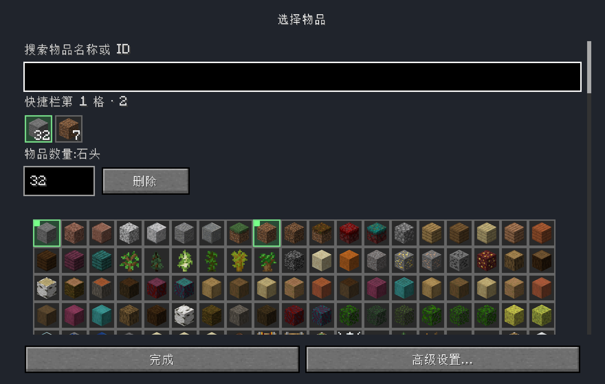
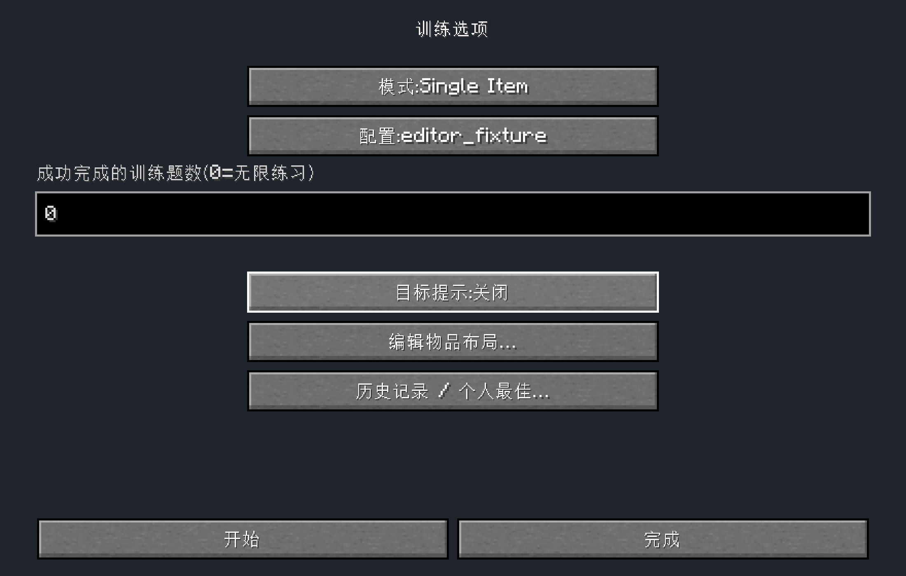

# Configuration copy and quantity-row follow-up — 2026-10-30

Requested changes are implemented:

- The goal input uses “Number of successful training tasks (0=unlimited)” above
  the field. The duplicate “Training task count” title, below-field explanation
  and manual-stop wording are gone. Chinese uses the same concise structure.
- Picker heading is position/count, for example “Hotbar1 ·2”. The catalogue size/
  click/green instructions are removed, as is the decorative item-name ×.
- Quantity input is left-aligned beneath “Item quantity: item name”, with a
  readable Delete button adjacent. Search, selected icons/counts, green marks,
  inline quantity drafts and ordinary toggle semantics are unchanged.
- Advanced remains a secondary footer entry. Benefit: existing random-empty,
  conserved-leftover and full NBT/matching settings stay editable. Cost: one
  extra entry. Daily selection/quantity edits do not need that page. Removing it
  would remove GUI coverage for those existing contracts, so it is retained.

There are no draft/domain/persistence/protocol/history/PB/recovery changes. The
same ProfileEditorSession and exact repository Edit own all changes; only main
Save writes. The previously fixed main/smoke Mixin export ownership is retained.

## Verification

Final JAR: `build/libs/hotbar-swap-trainer-0.1.0.jar`.
SHA256: `bcac3a75b58d7b6338331b1311ec7f7edb0aae433c7093e62a79d0a1877a7fb1`.
[Machine evidence](verification/m2-copy-layout-2026-10-30.json) records results,
artifact/manifests, unedited screenshot hashes and independent save readbacks.

The existing114-test suite and requested offline test/build and boundary checks
are rerun. These reversible text/layout changes do not add copy-mirroring unit
tests. The isolated production-client driver instead exercises Delete→EMPTY and
asserts quantity/Delete alignment and minimum-window bounds, in addition to its
existing complete multi-select/save/cancel/NBT/conflict/finite-unlimited flow.
Separate-process reopening verifies persisted data and captures Chinese screens.
Executed results are listed in the machine record; programmatic events/screenshots
remain distinct from pending human mouse/wheel/focus/readability acceptance.

Results: PASS —114 tests, zero failures/errors/skips; build and acyclic boundaries
(80 files/12 packages/27 edges);28 production programmatic stages plus independent
process restart and both post-exit saved-player readbacks. No human experience
acceptance is claimed. Main/smoke mapping separation remains verified in the JAR.

## Actual final-artifact screenshots

[English picker](verification/m2-copy-layout-2026-10-30/picker-en.png),
[English options](verification/m2-copy-layout-2026-10-30/task-count-en.png),
[minimum logical320×240](verification/m2-copy-layout-2026-10-30/minimum.png).
