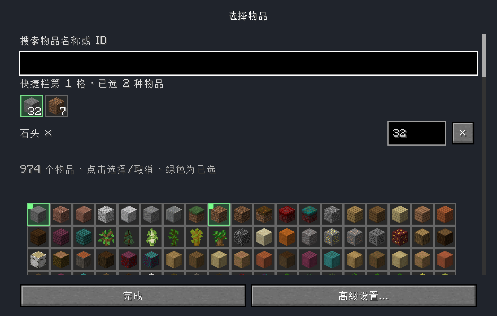
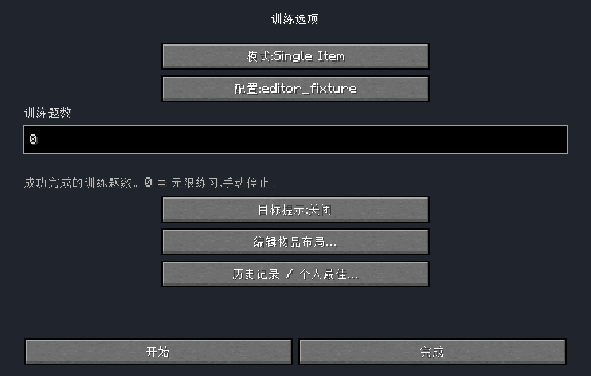

# M2 direct multi-selection — 2026-10-30

The later [copy/layout follow-up](m2-copy-layout-acceptance.md) supersedes the
labels/quantity-row positions and records its own production artifact. The
behavioral verification and original hash below remain historical evidence.

This revision replaces the earlier single-item proposal, exchange mode and separate
fixed/unlimited buttons. It changes the existing M2 editor, not training modes.

## Current interaction

**O → Edit item layout → profile → slot** opens the full searchable item catalogue.
Click icons to select/deselect any number of allowed items. All selected icons and
quantities appear above; selected catalogue items are green. Click a selected icon
to edit its quantity inline, or × to deselect it. Explicitly deselecting the last
item makes that slot EMPTY. **Done → Save layout** writes the profile.

One and many items use the same “Selected items: N” display. The overview contains
name, hotbar/offhand and Reset/Save/Cancel. There is no exchange mode, separate
quantity confirmation or main advanced-slot hierarchy. Advanced rule/NBT controls
remain a secondary picker footer entry. Opening/additive edits preserve complete
OPTIONAL/FLEXIBLE/custom NBT; only destructive custom/special removal asks first.

**Training task count** is one field, with “0 = unlimited; stop manually”. Positive
values count successful training tasks. Blank/bad/overflow text blocks Start/Enter,
stays raw across reflow/child return and cannot replace accepted preferences.
The existing nonnegative signed-int range, storage schema and history/PB contracts
are unchanged. The obsolete TrainingGoalDraft two-mode state was removed.

The O-page `Ready` was the server's ordinary IDLE catalogue response, rendered as
body text by TrainerOptionsScreen. That exact routine message is now filtered;
actual errors and other feedback remain visible. No server/protocol change.

## Ownership and safety

ProfileEditorSession owns the actual allowed-item list and per-item raw quantity/
SNBT through the existing exact source/Edit handle. There is no extra pending
single-item proposal or exchange state. Screens own search/active-icon view state;
main Save alone calls ProfileRepository. Atomic save, exact backup, conflicts,
failed-save draft retention, local/LAN/restoration restrictions and independent
server START reload/freeze are unchanged. No inventory, generation, timing,
completion or PB logic was changed.

## Verification

Final artifact: `build/libs/hotbar-swap-trainer-0.1.0.jar`.
SHA256: `f1907939041c6568a0587be56f319b6ba3fbc940b31ad0035a2701f57214d65a`.
Detailed hashes, results, build logs, save readbacks and screenshots are recorded in
[the machine evidence](verification/m2-multiselect-2026-10-30.json).

- Requested `scripts/gradle-jdk8.sh --offline test build`: PASS. **114 tests,
  zero failures/errors/skips**. The suite actually executed on the final Java
  sources; the final exact invocation/result reuse is distinguished in the logs.
- `python3 scripts/check-boundaries.py`: PASS, **80 production Java files,
  12 packages, 27 directed edges**, no forbidden dependency/cycle.
- `python3 -m py_compile scripts/run-profile-editor-ui.py` and
  `git diff --check`: PASS.
- Isolated remapped production-client workflow: **28 programmatic stages** cover
  direct multi-selection, all selected icons/marks, two quantities, saved empty,
  cancel with byte-identical file, raw count/SNBT across resize/children, complete
  custom pools, removal confirmation, conflict/write denial,0/positive/invalid
  training counts, missing obsolete controls/Ready and actual finite/unlimited
  sessions with confirmed two-save restoration.
- Separate-process restart verifies both allowed items (Stone32 and Dirt7), the
  three-item OPTIONAL/custom NBT pool, selected profile/unlimited preference and
  both real training histories. It also reloads Simplified Chinese resources and
  captures actual Chinese options/layout/multi-select pages.
- Independent post-exit typed NBT readback compares all41 inventory positions,
  selected slot6 and UUID in both host level.dat and UUID playerdata to the owned
  baseline, with no recovery marker. This is restoration evidence for these runs,
  not new crash-recovery acceptance.

Five focused coordinator tests now cover additive/deduplicated multi-selection,
per-item persistence, final deselection/reselection, custom variants and removal
confirmation, preserved OPTIONAL/FLEXIBLE and invalid raw counts. Existing source,
conflict/atomic-save/default/gate tests remain. Goal tests cover0/full old range,
invalid drafts and Ready filtering with retained real feedback.

The launcher uses an explicitly marked disposable instance and verified inactive
owned seed, isolated config, official Minecraft1.16.1, pinned Fabric dependencies,
Intel JDK8/Rosetta, original LWJGL3.2.1 and fabric.development=false. No daily config
or valuable save was used. The smoke driver is excluded from the production JAR.

## Build-output regression discovered by actual launch

An intermediate JAR failed before world entry: ServerPlayNetworkHandlerMixin's
@Shadow field remained `player` instead of `field_14140`. Loom0.4 let main and
smoke annotation processors overwrite one shared Mixin export. After compiling
smoke, a resource-only rebuild could therefore ship an unmapped production field,
even while unit tests and the method refmap looked correct.

The fix gives main/smoke distinct export ownership, declares producer outputs and
remap input, and disables partial compilation for the two aggregating processors.
Dependencies and game hooks are unchanged. A regression check actually compiled
smoke, made a resource-only locale-whitespace change, rebuilt with compileJava
UP-TO-DATE, and verified the remapped field and unchanged main export. Locale bytes
were restored exactly and the final requested build rerun. The failed attempt is
preserved and is not counted as acceptance. See [build support](../build-support/README.md).

## Limits and reproduction

These are real rendered-client/programmatic widget events and real server sessions
with supplied acknowledgements and vanilla swap handlers. They do **not** establish
human physical-input, reaction-time or subjective usability acceptance. Real wheel,
held/rebound keys, Tab/Enter/Esc through long lists, clipped potion/NBT tooltips and
long-name readability in both locales remain pending. The full previous M1
crash/fault/LAN matrix was not rerun for this GUI artifact; old hashes remain
historical and ordinary-world training remains gated.

```sh
scripts/gradle-jdk8.sh --offline test build smokeJar
python3 scripts/run-profile-editor-ui.py --usability --run-name run-m2-ui-NEW --launch
python3 scripts/run-profile-editor-ui.py --usability --run-name run-m2-ui-NEW --reopen --launch
python3 scripts/verify-m2-saves.py --run-name run-m2-ui-NEW
```

Use a new direct owned run name. Preparation refuses unowned/overwritten instances
and active recovery seeds. Source-selection, backup and persistence contracts stay
in ProfileRepository. No further unrelated refactor is needed.

## Actual client screenshots

Unedited final-artifact framebuffer captures:





[Compact main page](verification/m2-multiselect-2026-10-30/main.png),
[green catalogue marks](verification/m2-multiselect-2026-10-30/catalogue-marks.png),
[zero selected items](verification/m2-multiselect-2026-10-30/empty.png),
[minimum logical320×240](verification/m2-multiselect-2026-10-30/minimum.png).
