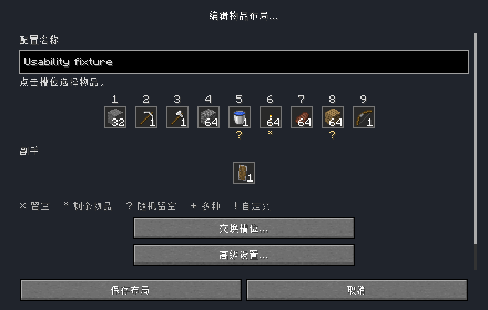
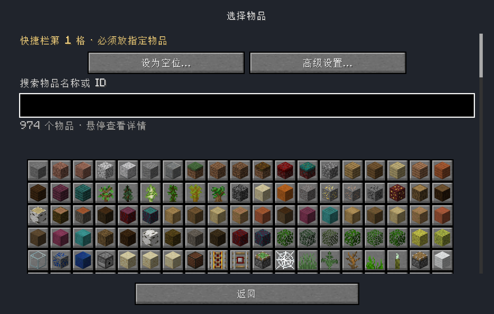
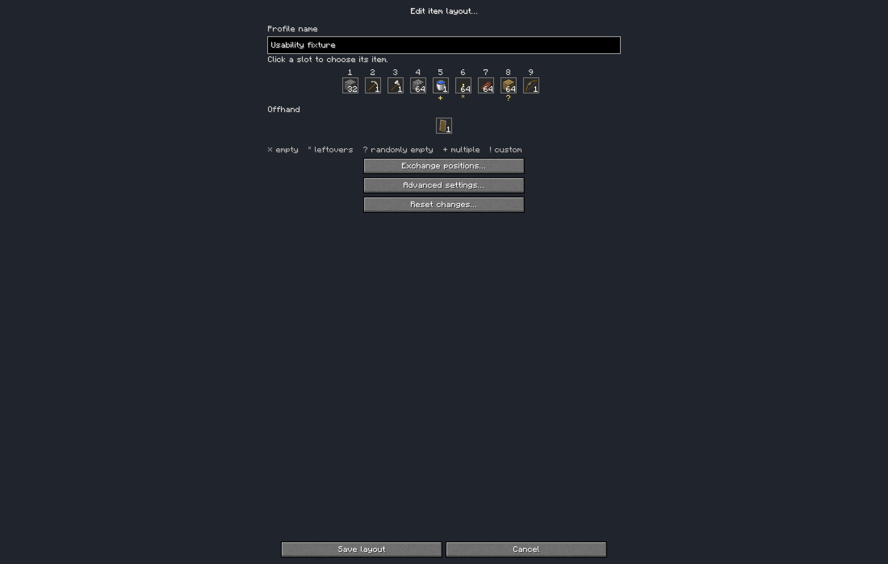
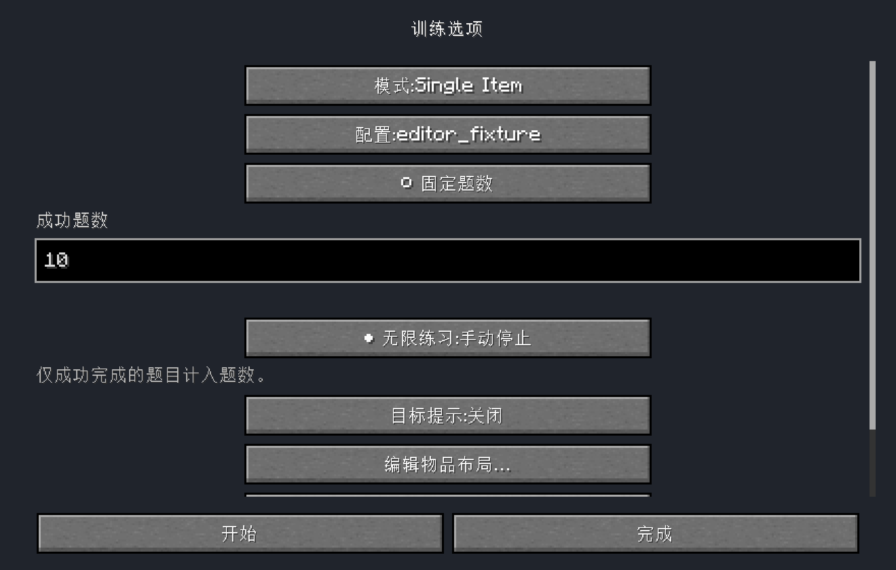

# M2 configuration usability acceptance — 2026-10-30

Historical artifact: superseded by the direct multi-select revision in
[m2-multiselect-acceptance.md](m2-multiselect-acceptance.md). The fixed/unlimited
buttons, exchange action and single-item proposal described here are removed.
This record retains its original artifact hash and executed evidence.

Implementation complete. Human experience acceptance remains pending. This is an
M2 GUI change, with no new training mode, M3, protocol, history/PB grouping,
generation, completion, timing or inventory recovery change.

## User flow and retained contracts

O → **Edit item layout…** → choose an existing profile → click a hotbar/offhand
slot → search name/ID and click an icon → confirm quantity → **Save layout**.
Nine hotbar positions and the offhand have item/count previews. **Set empty**,
**Exchange positions**, reset/cancel and a collapsed advanced entry are available.
Ordinary selection creates one required allowed item, default count1, bounded by
its actual stack limit. Existing multiple items, optional/leftover rules and
explicit NBT/matching require confirmation before ordinary replacement. Advanced
rules use natural language; FLEXIBLE accepts conserved leftovers and may use its
configured filler pool during generation, never arbitrary new items.

Training options offer **Fixed task count** with positive input, or **Unlimited
practice: stop manually**. Switching back restores even invalid raw fixed text;
invalid fixed drafts block Start/Enter. Existing 0=unlimited/positive=successes,
signed-int range and schema1 options remain compatible without migration.

ProfileRepository/ProfileDraft/exact Edit handles, raw SNBT/null versus {}, exact
backups, atomic replacement, conflict detection, server-independent START reload
and frozen profiles are retained. Screens perform no JSON I/O. One client
ProfileEditorSession owns counts, unconfirmed per-slot item/quantity/search,
reset/save baseline and typed feedback. Child return/reflow writes nothing.
Pending selections block Save and participate in dirty exit confirmation.

## Executed verification

Final remapped production JAR: `build/libs/hotbar-swap-trainer-0.1.0.jar`.
SHA256: `1e65f8f56cbae00a5d660c9eef3abe35d5cf663e79a424b277cab921a1d424e7`.
The same bytes are in the verified instance. Audit: 121 classes, all version52;
no smoke/acceptance classes; English/Chinese resources present, 101 matching keys.

- `scripts/gradle-jdk8.sh --offline test build`: PASS. Final exact invocation
  reused the test result; the immediately preceding final-production build
  actually executed **113 tests, zero failures/errors/skips**. Six new tests
  extend existing goal/session suites. Logs and XML totals are in the linked
  machine evidence. `smokeJar` separately compiled the excluded driver.
- `python3 scripts/check-boundaries.py`: PASS, **81 production Java files,
  12 packages, 27 directed dependencies**, no cycle or forbidden edge.
- `python3 -m py_compile scripts/run-profile-editor-ui.py`: PASS.
- `git diff --check`: PASS.
- Actual production client: **37 programmatic steps PASS**, normal exit0, in
  `run-m2-ui-usability-release-20261030/`. Uses official Minecraft1.16.1,
  Loader0.9.3+build.207, pinned Fabric API0.18.0+build.387-1.16.1, Intel JDK8
  under Rosetta and original LWJGL3.2.1; fabric.development=false. Launch manifests
  retain every dependency/native/mod hash. Only a verified inactive marked
  disposable seed and separate local config were used.
- Full client exit/relaunch: PASS for selected profile, unlimited preference,
  saved stone32, OPTIONAL pool of three items with full custom NBT, and two real
  histories. Separate process also reloads en_us→zh_cn resources and renders
  Chinese options/layout/picker. Screenshots wait until the loading overlay closes.
- Independent post-exit standard-library typed NBT reader: PASS for both host
  level.dat and UUID playerdata, all **41 inventory positions, selected slot6,
  UUID and absent recovery marker**, against the owned baseline. This is a current
  editor/training restoration readback, not new crash-recovery acceptance.

### Actual production scenarios

| Scenario | Observed result |
| --- | --- |
| Slot1 → Stone → count32 → main Save | Memory preview changed first, source stayed byte-identical until Save, saved/reloaded32 |
| Change count to7 then cancel profile | Dirty-exit confirmation; file bytes unchanged |
| Existing three-item pool and custom potion NBT | Lossless open; OPTIONAL change confirmed; allowed-item count and typed generation NBT edited/saved; all three alternatives and other complete NBT retained |
| Complex ordinary replacement, rule change and removal | Confirmations shown; Esc retained complete original settings |
| Empty and whole-rule exchange | Explicit empty confirmation; grid moved complete rules; reset restored baseline |
| Quantity65 for stack limit64, blank counts, unfinished SNBT | Confirmation/Save blocked; raw text retained across child return, screen resize and GUI scale |
| Unconfirmed ordinary selection on returning to main | Kept per-slot; reopening/advanced return retained blank quantity; reset explicitly cleared it |
| External source conflict and actual POSIX directory write denial | Saved file retained; current edits retained; explicit reload required and worked after repair |
| Fixed73 → unlimited → fixed; blank Start/Enter | Restored73; 0 backend unlimited; blank did not start or substitute a default |
| Fixed1 and unlimited selected through options → actual training | Real START packet; server independently loaded saved profile. Programmatic READY/GO_ACK and vanilla server swap handlers solved one task each. Fixed ended COMPLETED; unlimited ended STOPPED. Both restored inventory and saved history |
| Native640×480 Retina framebuffer1280×960, GUI scales1/2/4 | Actual logical320×240 at scale4; nine hotbar/offhand and fixed Save/Cancel reachable; scroll retains drafts. Opaque forms prevent HUD/title overlap |
| Fresh process | Saved options/profile/NBT/quantities and both training histories reloaded |

The training driver deliberately supplies acknowledgements and invokes vanilla
server packet handlers. These are real sessions, saves and rendered production
screens with **programmatic input**, not physical reaction-time or human usability
acceptance. It does not claim ordinary-world enablement or M3 support.

### Reproduction

```sh
scripts/gradle-jdk8.sh --offline test build smokeJar
python3 scripts/run-profile-editor-ui.py --usability --run-name run-m2-ui-NEW --launch
python3 scripts/run-profile-editor-ui.py --usability --run-name run-m2-ui-NEW --reopen --launch
python3 scripts/verify-m2-saves.py --run-name run-m2-ui-NEW
```

Choose a new direct run name; preparation refuses overwrite/unowned paths and
checks seed ownership and absence of recovery data in both saved player copies.
`--reopen --refresh-smoke` archives the prior driver/manifest/result/screenshots
before replacing only the excluded acceptance mod. Production mod hashes are
verified first. It was used in earlier isolated diagnostic runs to repair screenshot timing.
The final release instance uses the same smoke-driver hash for its37-step run
and separate-process restart.

## Evidence and remaining checks

[Machine record](verification/m2-usability-2026-10-30.json) contains final hashes,
first/restart result paths, screenshot hashes, readbacks and test totals.
Raw earlier runs are preserved. The first stopped at a test-only wrong assumption
that a Retina native640×480 window at scale2 implies logical320×240; it actually
has framebuffer1280×960. The corrected driver uses scale4. A later screenshot
capture included the resource-loading fade despite completed reload; the driver
now waits for MinecraftClient.getOverlay()==null. Neither was reported as a
complete visual pass. Screenshot review also prompted the opaque form background
to prevent underlying HUD overlap; the final production run includes that fix.

Pending **human** checks: real mouse/wheel, rebound/held keys, repeated input,
Tab/Enter/Esc focus through long lists, clipped vanilla potion/NBT tooltips,
long names/readability in both locales and native minimum window/scales. Current
unit tests retain join/active/restoration/error/LAN gates, and the new live run
checks active entry/save rejection. The full earlier M1 crash/fault/LAN matrix
was not repeated on this GUI artifact; its old hashes stay historical. Ordinary
save training remains gated. Use [manual-acceptance.md](manual-acceptance.md).

No unrelated refactor is needed. The change adds no package dependency direction.

## Actual client screenshots

These are unedited Minecraft framebuffer captures from the final production hash
above. Chinese main layout includes the collapsed advanced entry; separate English
capture shows the complete collapsed main view. More raw captures remain in the
owned instance. GUI-scale and framebuffer dimensions are in the machine record.

Main layout (Simplified Chinese):



Item picker (Simplified Chinese):



Collapsed advanced entry on the main page (English):



Fixed/unlimited count choices (Simplified Chinese):



[Quantity confirmation](verification/m2-usability-2026-10-30/quantity.png),
[minimum logical320×240](verification/m2-usability-2026-10-30/minimum.png),
[fixed-one selected](verification/m2-usability-2026-10-30/fixed-one.png).
