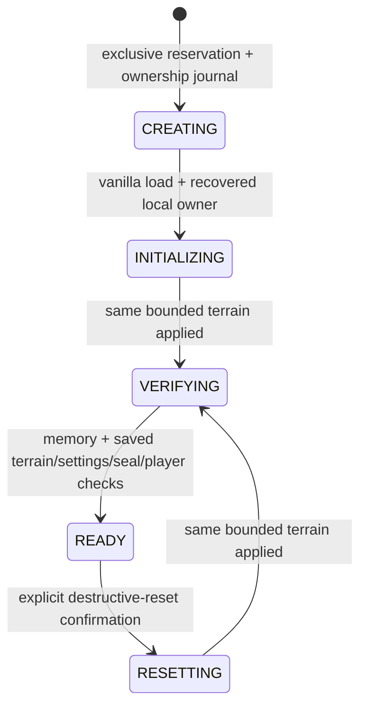

# M3-B: owned practice arena

Status (2026-11-06): implemented. Unit/build and the final seven-case production
matrix passed; manual physical-input/visual acceptance remains pending. The
working tree was clean at the start. No earlier changes were reset or committed.

## Confirmed product decisions

- One entry on the title screen; automatically create or reuse the owned save.
- Exit to the title screen. Never remember/reopen another world.
- Keep O/P, profiles, both inventory modes and Stationary/Moving unchanged.
- No courses, checkpoints, movement thresholds, difficulty selector or new stats.

## Execution plan

1. Audit the pinned vanilla creation/load/save/exit and flat generator sources.
2. Implement a strict path-bound ownership journal, fixed arena specification,
   recoverable initialization/reset and independently checked persistence.
3. Wire a server-side readiness gate and stop/confirmed-inventory-restore ordering;
   retain all existing recovery bindings and ordinary disposable-world gates.
4. Add the title action, non-pausing progress/error screen and arena-only reset/exit
   actions in O. Localize new strings in en_us and zh_cn.
5. Add meaningful ownership/lifecycle tests and an excluded production driver in
   a separately marked instance. Run unit tests, boundary checks, build and real
   lifecycle/interruption checks. Record precise results and unexecuted checks.
6. Synchronize architecture, module contracts and user instructions; stop at M3-B.

## Pinned-source audit

Locally generated Loom sources: Minecraft 1.16.1 / Yarn 1.16.1+build.21.
Do not redistribute vanilla source files.

- `MinecraftClient.method_29607(String, LevelInfo, RegistryTracker.Modifiable,
  GeneratorOptions)` creates using the original vanilla resource/session path.
  `startIntegratedServer(String)` loads an existing world. These run on the client
  thread; vanilla renders its loading screen while waiting for server readiness.
- `GeneratorOptions.method_28608` replaces the overworld generator in the vanilla
  dimension registry. `FlatChunkGeneratorConfig` supports explicit layers, no
  features/lakes and empty `StructuresConfig`, avoiding a custom generator.
- GameMenuScreen calls `ClientWorld.disconnect`, then client.disconnect and opens
  TitleScreen. `MinecraftServer.isStopping()` checks server thread death, despite
  its name. Client.disconnect keeps rendering until that signal. The separate
  `stopped` field is set before shutdown and is NOT a save/close acknowledgment.
- `MinecraftServer.save` and the vanilla player/level writers do not acknowledge
  all I/O errors. Chunk save clears the dirty bit before queued writes finish.
  Never infer durable arena readiness from their return values. Flush followed by
  read-only saved-chunk/metadata readback is required; retries must dirty chunks.
- Server end-tick is the sole terrain mutation boundary. Session recovery runs
  before arena work; an unresolved inventory transaction blocks arena operations.

## Verification

Final artifact: `build/libs/hotbar-swap-trainer-0.1.0.jar`, SHA256
`d4a781c5e7b262b9b89ea848e75046390357c8afad211fedbe7efe3a25872b5d`.
All classes have major version 52; no smoke/UI acceptance classes are present.
Executed checks and remaining limits are recorded below.

## Implemented flow and safety contracts

The confirmed flow is title → Enter practice arena → automatic create/reuse and
inspection → existing O/P training. O and the adapted pause-menu exit return to
the title after restoration/save/close; no previous world is retained/reopened.
Only owned-arena O gains Reset and Return to title. Reset has one confirmation
because it discards blocks/container contents. No world list, seed/name/size
settings, courses, checkpoints, new movement conditions or new statistics.

The complete specification is centralized in ArenaSpec: fixed seed 163161,
Survival/Peaceful, no structures/features/lakes, no mob/day/weather/fire cycle,
bedrock y0/dirt y1–2/grass y3, safe spawn (0.5,4,0.5), border diameter 64. The
managed block cuboid is overworld x/z -32..31, y0..255 (16 chunks). Vanilla flat
world generation handles ordinary spawn chunks; mod cleanup never expands its
cuboid. Reset does not delete/recreate the save or implement entity cleanup or
arbitrary terrain backup/rollback.

Ownership is independent of the old disposable marker. ArenaLaunch exclusively
reserves a missing `saves/hotbar-swap-trainer-practice`, immediately writes a strict
version-1 journal, and validates existing ownership before vanilla loading.
Journal fields: stable UUID, exact normalized absolute path, spec/bounds,
operation/previous-operation UUIDs and phase. Atomic forced-file replacement,
strict bounded UTF-8/schema parsing and symlink refusal preserve failed raw data.
A separate atomic gzip NBT seal cross-checks identity/path/spec/operation; READY
requires both records. Existing unknown/ordinary/old-test data is never adopted.
The server recognizes arena ownership data, never a similar name or coordinates.

Persistent phases:

In-memory cursor/progress is disposable. Every pending operation replays the same
cuboid with the same operation ID; each tick compares at most four sections and
rereads exact ownership. A retry re-dirties chunks after failed vanilla I/O.
READY reuse inspects without terrain writes and asks for explicit reset if
changed. Inconsistencies stop, retain data and disable training. Creation cuts
before level.dat are resumable only with known pre-server artifacts; unexpected
files, missing established level data or broken ownership are never repaired.

All generation/reset writes execute on the integrated-server thread after the
local player's recovery. Direct section replacement removes block entities,
maintains counts/heightmaps/light/network/dirty state and avoids old-block
callbacks/drops that could affect the area outside the bounds. Verification
compares the full in-memory/saved block volume and requires no leftover container
data. Save/readback and atomic journal READY commit are distinct steps.

SessionManager keeps inventory authority. Root ticks recovery first and injects
only a world-readiness predicate into sessions; arena never imports sessions,
stats, networking or clients. Ordinary marked-test training remains available;
owned READY grants the test gate separately without creating a disposable marker.
RESET/RETRY/EXIT first stop and confirm restoration. RESTORING/ERROR_LOCKED are
rejected without an implicit recovery retry. Explicit P/Retry inventory recovery
retains the original inventory implementation, raw damaged data and path binding.
Arena/statistics/notification errors cannot change recovery records or lock state.

Client requests follow vanilla input at END_CLIENT_TICK. Exit uses a real
EXIT_RESTORED → client EXIT_COMMIT → restored snapshot and saved-player/current
owned-terrain checks → EXIT_READY exchange. Terrain exit checks preserve current
blocks and complete container NBT instead of comparing against/resetting the
flat template. If ownership is broken, ordinary vanilla exit remains possible
after inventory confirmation, without claiming arena readiness or repairing data.
A failed final exit keeps its inventory proof/intent; Retry repeats exit, not
terrain reset. Then vanilla waits/render-loops until the server thread ends after
saving/closing its session lock. No fixed sleeps establish completion.

## Acceptance method and scope

- Unit tests use temporary owned directories and fake bounded terrain ports for
  lifecycle cuts; they are not real game/process acceptance.
- Production driver uses pinned Minecraft 1.16.1/Fabric/Intel JDK8/Rosetta/original
  LWJGL and the actual remapped production jar, not development runClient.
- `lifecycle`: actual title widget and adapted pause exit; four mode/environment
  combinations through real session/vanilla swap handlers; active-training reset
  and exit; same-path reopen; existing loaded outside-chunk hash unchanged.
  A known owned chest fixture verifies discarded container data does not drop.
- `safety`: actual RESTORING save-boundary observation; real POSIX host-write
  denial produces ERROR_LOCKED and rejects world operations; explicit retry
  restores both files. Separate real seal-directory write denial leaves arena
  VERIFYING with inventory already restored; retry replays bounded work. One
  excluded **simulated** final-exit save exception checks exit retry behavior.
- Five real `Runtime.halt(91)` process cuts: ownership before vanilla creation,
  initialization, server READY commit before client readiness publication, reset,
  and an active same-path inventory recovery transaction. Each archives raw
  forensic saves and must reopen the original path in a new process, finish
  lifecycle and exit0. Forensic copies are never loaded/rebound.
- Terrain work deliberately waits for the connected local player's recovery;
  there is no speculative generation before player data loads. The READY cut
  tests completion before client readiness publication, not pre-login generation.
- Independent standard-library NBT readback occurs after process exit, checking
  both host/UUID saved players, 41 slots, selected slot 6, player UUID, absent
  recovery and matching ownership/seal.

Final executed checks:

- `scripts/gradle-jdk8.sh --offline test build smokeJar`: passed. 154 unit tests,
  zero failures/errors/skips. This includes ownership/preflight/seal corruption,
  path-copy refusal, repeated/bounded initialization/reset, artificial lifecycle
  cut/replay, failed save/readback, region padding/truncation, block-entity NBT,
  protocol rejection and the existing training/profile/recovery/history tests.
- `python3 scripts/check-boundaries.py`: passed, 100 production Java files,
  13 packages, 35 directed dependencies, no cycles. New guards additionally reject
  arena→session/stats/network/root, session→arena and network→arena internals;
  direct rejection/allowed-DTO probes passed.
- `git diff --check`, Python compilation of changed/new runners/checks and exact
  en_us/zh_cn arena-key parity: passed. Production class/version/leak checks passed.
- `python3 scripts/run-arena-matrix.py --prefix run-arena-20261106-ownedfinal
  --report docs/verification/m3-b-2026-11-06/runtime-matrix.json`: **passed all
  seven cases**. Twelve actual production processes (two normal scenarios and
  five halt91/reopen pairs); actual title/pause widgets, four training conditions,
  known chest removal without drops, outside-chunk preservation, real POSIX I/O
  failures, actual RESTORING/ERROR_LOCKED gates, simulated final-exit save retry,
  exact READY-before-publication cut, same-path recovery and genuine closes.
- Each case's `verify-arena-save.py` independent post-exit NBT check passed:
  41 positions, selection 6, UUID, cleared recovery in both authoritative files,
  and matching ownership/seal. Archived active recovery in both files was also
  independently checked to retain the original exact world path; forensic
  copies were never loaded or rebound.

[Final matrix and readbacks](verification/m3-b-2026-11-06/runtime-matrix.json)
record exact artifact/manifest hashes, cut states, outcomes and per-file hashes.
Raw worlds/logs stay in the explicitly owned instances; each reopen archives
previous launch evidence. Two earlier completed matrices are retained as
`runtime-matrix-before-exit-retry.json` and
`runtime-matrix-before-container-readback.json`; their artifact hashes are
separate and are not relabelled as final-artifact acceptance.

## Existing marked-world regression

The final artifact additionally passed `run-m2-runtime.py --mode accept-moving
--run-name run-m2-runtime-m3-b-20261106 --launch`: **13** existing M3-A production
checks, including accepted walk/sprint/jump/stop, both environments/modes,
interruption/airborne protection and exact restoration. This is programmatic
handler/protocol acceptance, not physical input/feel. Post-exit
`verify-m2-saves.py --run-name run-m2-runtime-m3-b-20261106` passed both saved
players. Independent typed NBT palette/block-state comparison found all **625**
original full chunks unchanged, 625 after, with no arena journal/seal created.
The old test marker retained training permission only. This regression copied
only the already verified inactive owned seed; no recovery-bearing world or
record was rebound. Unknown/same-name/corrupt ownership paths were exercised in
temporary-directory unit fixtures, not against valuable user saves.

[Combined artifact/check record](verification/m3-b-2026-11-06.json) and
[legacy terrain result](verification/m3-b-2026-11-06/legacy-terrain-after.json)
retain exact evidence. The read-only terrain helper is archived beside its
before/after hashes for reproduction.

## Failed probes retained and corrections

1. Initial live save differed from plain-NbtOps unit fixtures: vanilla registry ID
   encoding caused a safe generator-check rejection. Corrected fixtures and
   preflight to the actual RegistryReadingOps writer; no gate was weakened.
2. Readback initially rejected unused unpadded bytes at the final sector of an
   open region. Corrected to validate actual payload bounds; added regression.
3. Test tried START immediately after reset teleport, before onGround. The safe
   start gate correctly refused; fixture now waits for actual onGround.
4. Real reopen caught selected-slot 0 instead of baseline 6, although every item
   matched. Corrected the world-exit packet ordering with the explicit restore/
   end-tick acknowledgment barrier, then independently verified both files.

Failed logs/results remain in `run-arena-20261106-lifecycle` and
`run-arena-20261106-final` plus their launch archives. Pending initialization
was retried only inside its already owned area. The failed-selection save was
kept as evidence, not patched from the fixture baseline. No recovery record was
rebound or copied to another playable world to make a check pass.

## Remaining manual/platform limits

Physical keyboard/mouse input, subjective movement feel and visual/focus/pause
acceptance remain manual; the driver supplies protocol/input programmatically and
accelerates training deadlines. Native minimum-window/localized visual acceptance
has not been executed for M3-B. This task does not repeat the entire historical
M1 corruption/mid-write matrix or prove arbitrary power-loss/fsync-directory,
hostile concurrent filesystem changes, other mods, networked/LAN play, arbitrary
entity cleanup or arbitrary terrain rollback. No valuable/unknown real save is
used for destructive acceptance. Ordinary-world gates stay in place.

M3-B stops here; M3-C remains outside this implementation.
