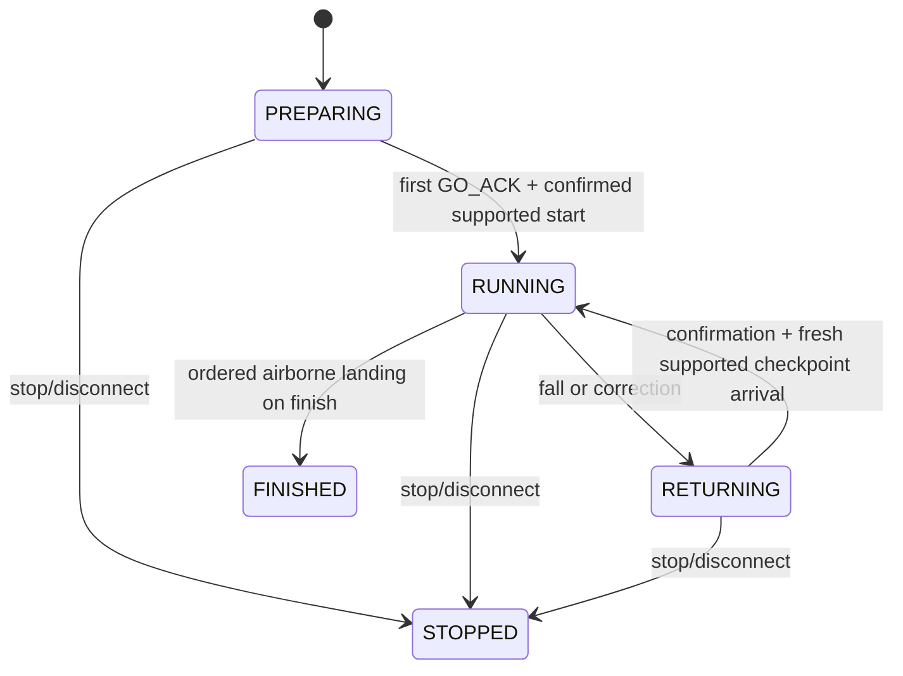

# Basic course contract

This pure module supplies immutable geometry and a disposable attempt state
machine. It imports no Minecraft/runtime/file classes or consuming modules.
`arena` materializes the geometry, `environment` adapts actual server positions,
`session` coordinates independent inventory and course completion, and `stats`
freezes results. There is one course, not a registration/plugin framework.

## Configuration

`BasicCourse(seed)` is deterministic for `basic-parkour-v1`. The owned arena uses
seed 163161. Thirteen 3x3 full-block platforms at block y8 form twelve level,
cardinal jumps with one-block gaps. Seed chooses rotation only. All platform and
head/body clearances are inside x/z=-32..31, y=0..255. Start is index 0, each
intermediate platform is a sequential checkpoint, index 12 is finish. Floor at
y3 belongs to the base arena; feet below 7.5 or outside the allowed route cause
return before an ordinary landing on that floor. No equipment or item use.

`Platform.supports` checks feet height and the entire normal player footprint;
it is a geometry predicate, **not collision proof**. The environment must also
verify actual support, body clearance and valid locomotion state. Geometric
one-gap templates still require human route-completion acceptance.

## Attempt

`CourseAttempt` is server-thread mutable and takes a caller-supplied monotonic
timestamp. `start` requires confirmed supported start and runs only once.
`accepted` requires fresh vanilla-accepted positions, not requested coordinates.
Only an airborne-to-supported landing on exactly the next platform advances.
A displacement discontinuity exceeding two blocks in one observed segment
re-arms through RETURNING rather than awarding progress. This conservative
ordinary-movement bound is independent of M3-A's diagnostic Moving observations.

`fall` counts once on RUNNING -> RETURNING. Corrections revoke confirmation and
airborne evidence. Confirmation alone never advances; fresh supported arrival
at the authorized checkpoint re-arms and returns without evaluating the next
checkpoint. A teleport to finish cannot bypass the sequence. Course time
continues during returns and pauses, freezes at finish/stop, and never resets on
another inventory GO_ACK. FINISHED is stable even if inventory solving continues.

The instance is discarded on disconnect/shutdown/crash, never serialized in
inventory recovery or resumed with offline time. Frozen results may be saved
only outside confirmed inventory restoration. Full rules and verification:
[M3-C](../../../../../../docs/m3-c-parkour.md). Tests: `src/test/.../course`;
actual adapters/position driving live only in the excluded smoke module.
